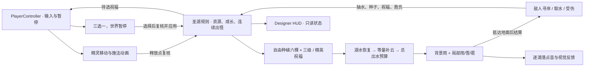
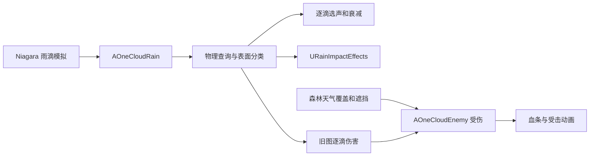

# OneCloud 项目结构

想查某个文件时，直接打开[逐文件理解指南](#逐文件理解指南)。想先理解一局如何运行，沿下方的守湖流程阅读。

## 按一次守湖读项目

从 `L_ForestLake` 开始。先在 **World Settings** 看这张地图选择了哪个 GameMode，再在世界大纲找到 `精灵`、`玩法/森林圣湖 · 规则`、`圣雨` 和 `湖心岛/圣树 · 古橡`。跟着下面的顺序读，先观察游戏现象，再打开负责它的资产和代码。

### 1. 地图怎样变成正在运行的游戏

`.umap` 保存场景中的 Actor、组件和实例属性。Play 时 UE 建立 PIE 世界，并从编辑器地图复制运行用的对象。蓝图类默认值提供初始配置，关卡实例可覆盖这些值。例如调整森林规则的种植范围时，先看场景中规则 Actor 的 Details，再看蓝图或 C++ 构造时的默认值。

`DefaultEngine.ini` 指定森林默认地图和 `BP_ForestLakeGameMode`，森林图的 World Settings 也显式选择该模式。GameMode 的 `StartPlay` 先调用父类启动世界，再用一次 `SetTimerForNextTick` 调用 `BeginLocalSession`，把本地会话交给 `AOneCloudPlayerController::BeginSession`。菜单接管前，Spring Arm 已完成首帧定位，避免暂停在角色体内。控制器显示开始菜单，玩家确认后创建漫画；带 `SkipIntro` 的重试直接恢复游戏输入。负责湖水、敌人和胜负的是地图里放置的 `ASacredLakePrototype`。它在 `BeginPlay` 初始化水量、绑定输入和连接场景引用。森林图按 R 先交给控制器确认重试，确认后才调用规则的 `Retry`，用带 `SkipIntro` 的关卡 URL 重开。 [项目启动代码](../Source/OneCloud/Game/OneCloudGameMode.cpp) · [玩家会话控制](../Source/OneCloud/Player/OneCloudPlayerController.cpp) · [关卡规则初始化](../Source/OneCloud/Game/SacredLake/SacredLakePrototype.cpp) · [UE Gameplay Framework](https://dev.epicgames.com/documentation/en-us/unreal-engine/gameplay-framework-in-unreal-engine)

UE Build Tool 根据 `OneCloud.Build.cs` 确定模块和依赖。Unreal Header Tool 处理 `UCLASS`、`UPROPERTY`、`UFUNCTION` 等反射声明，让编辑器、蓝图和序列化系统识别 C++ 类型。读属性时分别看它是否可在 Details 中设置、是否可在蓝图中读写，以及是否是 GC 能跟踪的对象引用。水量结构 `FSacredLakeResources` 是普通 C++ 值类型，地图、蓝图、材质和网格是可加载的 UE 对象。 [模块依赖](../Source/OneCloud/OneCloud.Build.cs) · [水量结构](../Source/OneCloud/Game/SacredLake/SacredLakeResources.h) · [UE Gameplay Objects](https://dev.epicgames.com/documentation/en-us/unreal-engine/gameplay-objects-in-unreal-engine)

### 2. 漫画怎样交回操控

`WBP_OpeningComic_Forest` 的 `PageHost` 放七页，`Panels` 放每页的画格。C++ 记录页码和已显示格数，UMG 动画处理进入、翻页和淡出。`BeginComic` 暂停游戏世界、关闭三维画面并切到 UI 输入，漫画仍由界面播放。结束时先恢复世界，再把输入焦点和光标交回玩家。`SheetUVMin`、`SheetUVMax` 决定从整页贴图的哪里取图，Canvas 决定格子放在屏幕的哪里。这是纹理采样和界面排版两个步骤。 [漫画播放器](../Source/OneCloud/UI/Comic/OneCloudComicWidget.cpp#L33) · [画格裁切](../Source/OneCloud/UI/Comic/OneCloudComicFrame.cpp#L7) · [七页蓝图与调整入口](OpeningDesign.md#当前游戏里的漫画入口)

退出分为两段时间轴：`ExitToBlack` 完成后恢复世界，`RevealWorld` 完成后才交还输入、移除漫画并广播 `OnReadingFinished`。控制器收到通知再显示局内 HUD。因此「世界已经不暂停」不等于漫画交接已经结束；调试这段流程时应观察完成事件和实际控件可见性。

### 3. 精灵如何移动、看向目标和播放动作

`IMC_Fairy` 把按键和鼠标映射到 Input Action。精灵的 `Move` 按相机水平朝向把二维输入换成世界方向，升降走 `Fly`。它把输入交给 Character Movement 的 `MOVE_Flying`，由移动组件处理速度、加速度、制动和胶囊体的移动。PlayerController 的控制旋转驱动 Spring Arm 上的相机，身体朝向由运动方向驱动。所以可以抬头瞄准，同时保持水平飞行。 [角色输入与移动](../Source/OneCloud/Player/OneCloudFairy.cpp#L60) · [Enhanced Input](https://dev.epicgames.com/documentation/en-us/unreal-engine/enhanced-input-in-unreal-engine) · [UE Movement Components](https://dev.epicgames.com/documentation/en-us/unreal-engine/movement-components-in-unreal-engine)

Skeletal Mesh 记录网格怎样跟随骨骼，Animation Sequence 提供各时刻的姿态。`OneCloudFairyAnimInstance` 读实际速度和加速度，输出悬停、起步、巡航、停止或转身。`ABP_ForestFairy` 读取姿态数据，把对应动画混合后输出到骨骼，拍翼叠在飞行姿态上。切换是否移动时还会调节跟随角色的翼声音量。Play 时打开 AnimBP 的 Debug Filter 选精灵实例，再按住、松开 W，可以同时看角色位移和动画状态。 [飞行姿态](../Source/OneCloud/Player/OneCloudFairyAnimInstance.cpp#L8) · [UE 动画混合](https://dev.epicgames.com/documentation/en-us/unreal-engine/using-layered-animations-in-unreal-engine)

### 4. 种树、补云与涨落水位怎样串在一起

从 `IMC_ForestLake` 的 `IA_ForestPlant` 找到 `BindForestInput`。E进入`PlantFromInput`打开种植预览，左键读取`ResolvePlantingAim`的地形落点并交给`TryPlantAtLocation`，右键或E取消。`ResolveForestPlant`统一检查岛界、最高水位净空、距离、障碍、种子和湖水；点中已有树根则只培育那棵树。首次生成真实树模型，后续复用同一Actor；生成和校验成功后才扣一颗种子与五点湖水。0.2秒规则计时器推进十二秒平滑成长，完成后增加总等级G，再由`RefreshForestGrowth`从基础值重算容量、恢复、自然补云和出水预算。F是紧急转移，自然补云与紧急转移都从湖水等量扣除。容量增加不会凭空补满水。具体公式见下方[当前水循环](#当前水循环)。 [种植和补云](../Source/OneCloud/Game/SacredLake/SacredLakeForestResources.cpp) · [成长与祝福](../Source/OneCloud/Game/SacredLake/SacredLakeBlessings.cpp) · [资源账本](../Source/OneCloud/Game/SacredLake/SacredLakeResources.h)

确认成功后`ToggleForestFocus`调用`CancelForestPlanting`，自动退出种植预览；失败时保留预览，让玩家继续移动准星选择地面。玩家不用在成功后再按E，再按会重新进入预览。

`UpdateWater` 将实际储量按 15、60、130 三个锚点换成世界高度。树提高容量以后，相同的实际储量仍对应同一水位。代码升降水面 Actor，同步写材质参数集合里的 `WaterSurfaceZ` 和 `LakeWater`。渲染端用这两个数控制湿岸表现，关卡规则用水面高度查询水线。湖水归零时水面隐藏并关闭查询碰撞。森林图的水面仅阻挡 `Visibility`，供雨滴查询落点和物理材质；对 `Pawn` 等通道忽略且不影响导航，角色的地板仍由地形碰撞提供。材质参数集合让同一个世界中的材质读取同一份水位。 [水位更新](../Source/OneCloud/Game/SacredLake/SacredLakePrototype.cpp#L256) · [UE Material Parameter Collections](https://dev.epicgames.com/documentation/en-us/unreal-engine/using-material-parameter-collections-in-unreal-engine)

### 5. 怪物为何能找到岸边并抽水

森林计时器从湖心外围的椭圆环带持续生成普通、精英和首领。每次按连续随机角度挑候选地面，用 NavMesh 投影和通往实时水线的完整干路筛选，再生成怪物；每次最多尝试16处，受阻后由原有计时器稍后重试。`ForestSpawnSeed` 固定随机候选序列，实际生成结果仍受路径、碰撞和玩法状态影响；`ForestSpawnHalfExtentCm` 调整林带距离。生成后的真实站位仍会重新寻岸。出生高度按胶囊未缩放半高与根组件默认相对缩放计算；CDO未注册时的世界变换缓存可能仍为1，不能用它估计放大首领的高度。UE 的 Recast NavMesh 提供可行走区域，AIController 的路径跟随组件沿选好的路线移动。编辑器按 P 看绿色导航区域，再跟 `IsDryPath`，就能看出哪些绿色路径因为涨水被项目规则排除。 [出怪与取水](../Source/OneCloud/Game/SacredLake/SacredLakeForestExtraction.cpp) · [岸线和路径查询](../Source/OneCloud/Game/SacredLake/SacredLakeShore.cpp) · [UE Navigation System](https://dev.epicgames.com/documentation/en-us/unreal-engine/navigation-system-in-unreal-engine)

抵岸回调触发攻击表现，抽水扣费由规则计时。紫色抽水流是 Spline Mesh，代码把湖面点与敌人位置转换到组件局部坐标，再用切线弯曲网格。雨或技能造成伤害后，敌人负责减生命、播放受击或死亡、刷新血条，规则收到击败事件后发种子或结束防守。湖干涸即失败，保有湖水并击败首领即可获胜。 [样条水流](../Source/OneCloud/Game/SacredLake/SacredLakePrototype.cpp#L322) · [敌人的寻路、受击和死亡](../Source/OneCloud/Enemies/OneCloudEnemy.cpp)

### 6. 施法动作怎样在对的时刻产生效果

`ResolveForestAim` 从相机视线查询地面目标。按技能键时 `RequestForestSkill` 检查目标和资源，暂存落点和施法编号，交给精灵播放 Montage。Montage 是可单独播放的动画时间轴，`ABP_ForestFairy` 的 `DefaultSlot` 把它接进当前飞行姿态。在 Montage 上移动 `SkillCommit` 通知的位置，可以改变哪一刻触发技能。角色同时核对通知名和 Montage 实例编号，规则再核对施法编号、冷却和资源，随后扣水并结算一次。动画提前结束且尚未提交时会取消待处理技能。缺少可播放 Montage 时，有直接提交流程供灰盒角色使用。 [技能请求与提交](../Source/OneCloud/Game/SacredLake/SacredLakeForestSkills.cpp#L176) · [Montage 通知处理](../Source/OneCloud/Player/OneCloudFairySkills.cpp#L19) · [UE Animation Montage](https://dev.epicgames.com/documentation/en-us/unreal-engine/animation-montage-in-unreal-engine)

水柱从半径内找可打断的目标，雪幕在持续时间内刷新减速，冰雹定时落下并对同一只敌人去重，星坠先预警再结算范围伤害。看 `OneCloudWeatherSkills.cpp` 时，先找范围和生效时刻，再看演出用的 Niagara、声音或地面标记。这样能分辨一个技能改了伤害规则，还是只换了看见的效果。 [主动天气效果](../Source/OneCloud/Weather/OneCloudWeatherSkills.cpp)

### 7. 一滴雨怎样看见、听见和命中

森林图的 `NS_ForestRain`、`NS_ForestSnow` 和 `NS_ForestHail` 负责粒子表现。背景雨保留一股发射，聚雨圈再从同一预算分出局部雨、雪或雹；没有聚雨圈就不发射局部天气。打开 Niagara，依次看 Emitter 的 Sim Target、生成和运动模块、Sprite Renderer，以及 `User.ForestSpawnRate`。GPU 批量推进粒子并导出候选落点，CPU 从 `ReceiveParticleData_Implementation` 接收数据，再沿 `Visibility` 查首个阻挡对象和物理材质。查询可能命中树冠代理或角色胶囊体。物理材质的 Surface Type 提供声音与特效的分类依据。 [雨滴回调](../Source/OneCloud/Weather/OneCloudRain.cpp#L123) · [物理表面配置](../Config/DefaultEngine.ini#L136) · [Niagara 数据导出](https://dev.epicgames.com/documentation/unreal-engine/API/Plugins/Niagara/UNiagaraDataInterfaceExport)

三套系统实际保存的 Export Data Interface 使用`PerParticle`分配、每粒系数1；UE的`fx.Niagara.NDIExport.GPUMaxReadbackCount`当前为1000，限制每个导出缓冲的容量。`FixedSize`里的64在该模式不生效，不应据此推断每批只能导出64滴。配置容量与运行时完整落点导出、混音可听性是不同的验收项。

逐滴声音的准确含义是：每条成功导出的粒子记录，经过CPU查询命中有效表面、找到对应音色且音频设备可用时，独立提交一次`PlaySoundAtLocation`。未导出、没有命中或没有音色的记录不会提交声音。提交后还要经过距离衰减、资产并发规则、声音优先级和设备声部预算；因此应分别观察粒子数、有效落点数、播放请求数与实际可听声部，不能只凭其中一个计数宣称所有雨滴都完整听见。特效限频只约束视觉表现，这条声音请求路径仍逐滴处理。

| 命中表面 | 显示什么 |
|---|---|
| 湖面 | 实例化涟漪与水花 |
| 沙地、泥土 | 随时间变淡的湿印 |
| 树冠 | 朝树冠代理内部修正位置的水花 |
| 盔甲 | 较快散开的水花 |
| 裸露皮肤 | 根据骨骼和物理体修正落点的水花与附着腐蚀效果 |

`RainImpactEffects` 对视觉效果做距离、限频和复用。`SelectWeatherImpactSound` 先查雪或雹的逐表面音色表，没有专用音色时交给 `SelectImpactSound` 按表面选雨声；声音用位置与衰减设置参与空间混音。森林战斗另外每 0.25 秒根据覆盖、聚雨、遮挡和天气克制结算。`RainFlightSeconds` 控制从云到地面的规则延迟，具体值先看场景实例；切换或收雨后仍会处理已经发射的阶段。旧图保留逐滴伤害路径。调 `Impact Volume` 可验证声音层，调 `Weather Rain Damage Per Second` 可验证森林伤害层。 [落点特效](../Source/OneCloud/Weather/RainImpactEffects.cpp#L133) · [落点选声](../Source/OneCloud/Weather/OneCloudRainAudio.cpp#L10) · [降水覆盖与伤害](../Source/OneCloud/Weather/OneCloudRainCoverage.cpp#L199) · [UE Sound Attenuation](https://dev.epicgames.com/documentation/en-us/unreal-engine/sound-attenuation-in-unreal-engine)

森林实例的规则飞行时间为3.5秒，雨、雪、雹系统的初始向下速度和速度上限均配置为2200厘米/秒；从约7600厘米的发射高度到开局水面，直落时间约3.45秒。粒子寿命设7秒以容纳地形高度差，寿命不是飞行时间。调整云底高度时，应一起检查Niagara速度、寿命和`RainFlightSeconds`；树冠或高岸会比水面更早接住粒子，逐滴选声仍以真实查询落点为准。这些配置说明不代替运行中的落地时序和声音验收。

森林收雨把`User.ForestSpawnRate`设为0，保持Niagara组件模拟已出生粒子，不用反复`Deactivate / Activate`表达天气开关。原因是组件在尾雨期间仍可能报告`IsActive=true`，立即重激活又可能重置GPU模拟；用零出生率能清楚区分“不再生新雨”和“空中雨仍在落”。局部天气切换同样把旧组件的出生率归零，只让新类型继续发射；稳定后最多两股有非零出生率，仍在模拟的尾粒子不代表又扣了一份水。旧地图保留原停发路径。

### 8. 场景画面如何被渲染

从 `圣树 · 古橡` 的 Static Mesh Component 打开网格和两个材质槽。网格提供顶点、三角形和 UV，树皮贴图提供颜色、法线与粗糙度，叶片材质用颜色贴图的 Alpha 裁出轮廓并做双面光照。Nanite 按屏幕需求选择几何细节，角色胶囊、雨滴查询代理和地形查询仍属于碰撞层。在森林图看 `MI_ForestWater` 如何配置单层水的吸收、散射和粗糙度，再看 `MI_ForestStorm` 的体积密度形状。体积云渲染通过视线采样密度形成厚度，降水覆盖由天气 Actor 单独配置。远林的 Megaplants 另有 Dynamic Wind 数据。 [场景资产与机位](Scene.md#森林圣湖) · [UE Nanite](https://dev.epicgames.com/documentation/en-us/unreal-engine/nanite-virtualized-geometry-in-unreal-engine) · [UE Volumetric Cloud](https://dev.epicgames.com/documentation/en-us/unreal-engine/volumetric-clouds-in-unreal-engine)

场景组件注册后，渲染器才能看到网格、灯光和雾。CPU 更新组件位置和材质参数，GPU 使用网格和材质着色，再结合直射光、阴影、间接光、雾与曝光得到画面。项目启用了 Substrate、Lumen 和虚拟阴影贴图。检查场景时，形状先看网格或体积密度，光色再看材质、灯光和曝光。检查碰撞时则分别看角色胶囊的 Sweep、雨滴的 Visibility Trace，以及 AI 的导航网格。它们服务于移动、落点和寻路三个问题。 [项目渲染配置](../Config/DefaultEngine.ini#L8) · [UE Substrate](https://dev.epicgames.com/documentation/unreal-engine/overview-of-substrate-materials-in-unreal-engine?application_version=5.8) · [UE Lumen](https://dev.epicgames.com/documentation/en-us/unreal-engine/lumen-global-illumination-and-reflections-in-unreal-engine)

闪电由短暂点亮场景灯表现。雷声按照光源到音频监听器的距离除以声速延后，再按场景位置播放。环境风、雨滴、翅膀和开场音乐分别使用各自的声音和播放入口。想理解看起来相似的两种变化时，先判断是材质参数变了、粒子生成变了，还是规则计时到了。 [闪电与雷声](../Source/OneCloud/Weather/OneCloudRainStorm.cpp) · [音频资产](Assets.md#音频)

### 9. 界面怎样拿到状态，怎么逐步调试

规则通过`UpdateHud`推送湖水、云水、种子、成长和胜负，`UpdateForestSkillHud`推送技能和天气抵达状态。`USacredLakeWidget`更新Designer控件；世界圆环与岸向标记仍由`ForestLakeGuidancePaint.cpp`按镜头投影。`FForestSkillHudState`保存费用、冷却、解锁、可用和有效目标；HUD不重新判定扣费。`SetForestObjective`接收单条情境目标，`ShowForestFeedback`显示约2.8秒短反馈，紧急目标不会被成功反馈遮住。精英奖励由规则广播`OnBlessingChoiceChanged`，控制器暂停游戏并展示三选一。调试先确认规则值，再确认HUD收到什么，最后在Designer核对控件。 [HUD状态](../Source/OneCloud/UI/Hud/SacredLakeWidget.cpp) · [技能槽](../Source/OneCloud/UI/Hud/ForestSkillWidget.cpp) · [祝福界面](../Source/OneCloud/UI/Blessing/ForestBlessingWidget.cpp)

| 练习 | 从哪里开始 | 观察什么 |
|---|---|---|
| 追一次 E | 在 `TryPlantAtLocation` 下断点，Play 后按E、瞄准岛上空地并点左键 | 距离和水位条件、生成树、扣费、成熟、HUD 更新 |
| 分辨位移和动画 | 在精灵实例调整 `Max Fly Speed`，对照 AnimBP 的 `FlightPose` | 移动速度改变，姿态随输入和加速度切换 |
| 看技能提交时刻 | 打开一项技能的 Montage，找到 `SkillCommit`，观察按键到提交的延迟 | 姿态、扣水、效果和冷却各在什么时候改变 |
| 分辨渲染与查询 | 查看圣树的叶材质与碰撞，再打开岛边小树的查询配置 | 看得见的叶片、可阻挡的几何、雨滴归类是不同设置 |
| 找性能瓶颈 | 固定同一机位，在无雨和开雨时分别用 `stat unit` 看 Game、Draw、GPU | CPU 游戏逻辑和渲染时间分别变化，再决定用 Insights 或 GPU 分析追哪一边 |

## 森林圣湖怎么玩和怎么读

当前是一局连续防守：敌人持续从整圈外围林带随机出现，玩家用成长提高水循环和雨量，用局部天气与技能处理快怪、精英和首领。没有需要清空后才能进入下一段的波次。按键见[README](../README.md#当前版本怎么操作)。调数值时先查看关卡实例；实例可以覆盖C++和蓝图默认值。

### 当前水循环

开局湖水60、云水35、种子1。G是已完成的树木等级总和，最多六棵树、各三级，G最高18；正在成长的一级尚不计入G。E进入预览，左键确认后才花一颗种子与5湖水，保留10湖水，12秒完成；右键或E取消预览。点中成长中或满级树会拒绝，不会自动改选别处。

| 项目 | 正式代码中的基础规则 |
|---|---|
| 湖容量 | `min(130, 100 + 5G)` |
| 云容量 | `45 + 5G + 15 × 云海层数` |
| 湖自然恢复 | 每秒`(0.35 + 0.16G) × (1 + 0.15 × 活泉层数)` |
| 自然补云速率 | 每秒`0.30 + 0.09G`，湖水低于`max(30, 湖容量30%)`时不继续转出，云的自然目标为容量70% |
| 紧急补云 | 仪式石范围内按住F，额外最多每秒4点，受云剩余空间与湖水10点保留量限制 |
| 实际降水用水 | 每秒`1 + 0.04G`，背景雨和局部天气共用它；云水耗尽停发，仍请求降水时攒够五秒用量再恢复 |
| 全云视觉发射率 | 基础每秒1500个，乘`1 + 0.04G`；G=0/6/18时配置为1500/1860/2580个粒子/秒。聚雨按同一总量分配背景和局部 |
| 基础雨伤 | 对裸露肉身每秒`3.5 × (1 + 0.04G)`点，再乘圣雨祝福；护甲和天气类型另用各自倍率。成长完成后整片基础雨都增强 |

补云的每一点都从湖水扣除。先计算一段时间的自然恢复，再按安全储量和云空间分配转移，最后扣实际发射用水。扩大容量只扩大容器，不填水。默认请求整片云降雨，Q可以手动停雨；`bForestRainEmitting`记录实际是否发射；缺水暂停不会把Q的含义反转。已在空中的粒子和地面阶段继续完成。

读状态变化时沿`SettleForestResources`开始：按上一次状态结清已过去的世界秒数，再修改补云、发射或技能状态。`ForestRainEmissionChanged`也先结旧账再切换`bForestRainEmitting`，避免开雨前的一段时间被追扣，或收雨前的一段时间漏扣。HUD读取结算后的资源，不靠界面刷新频率推进水量；GPU尾粒子发声与新粒子的水费也分开。

### 天气与技能

只要开启降雨且云水可用，整片云都有基础雨。树的有效总等级提高这片基础雨的密度和伤害，并非只有聚雨圈加强。左键建立聚雨圈后，Tab选择圈内的雨、雪或冰雹；没有聚雨圈时，选择类型不会把整片云改成雪/雹。局部最多分走40%的现有出水，半径过小时进一步限制分流，使圈内总密度不超过均匀覆盖的2.4倍，其余留给背景雨。粒子数量与伤害使用同一份分配，避免视觉增雨而账本未扣水。

森林地图的 `圣雨` 实例覆盖半宽为 `(5250, 4400)` 厘米，即约 105 × 88 米，聚雨半径为 1200 厘米，基础均匀雨伤为每秒 3.5。按这组面积，实际局部分流约 7.21%，背景保留约 92.79%；圈内叠加背景后到达 2.4 倍密度上限。40% 是允许的最高分流比例，不是当前场景的实际比例。成长后的总出水再乘 `1 + 0.04G`，具体克制倍率在下一段叠加。

圈内的基础雨不会因Tab选雪或冰雹而消失：它仍覆盖整片云，局部组件额外叠加所选类型。圈外只承担背景雨减少的那一小部分。阅读实现时，`SetForestRainBudget`把`ForestWaterRate`同时交给`UpdateNiagaraCoverage`和`QueueRainPhase / ResolveWeatherRain`，因此视觉雨量与地面伤害随同一倍率增长；`SetForestRainIntensity`保存的旧表现参数不再是这条森林降雨预算的乘数。

视觉基础采样从150个/秒调整为1500个/秒，使105×88米的雨区更容易看见落雨；这次只调整Niagara的视觉基础采样。森林规则独立按覆盖和天气每0.25秒结算，基础DPS仍为3.5，基础耗水仍为每秒1点，成长倍率仍为`1 + 0.04G`。逐滴音频继续来自实际粒子落点。发射率是配置数值，实际粒子、回读和音频吞吐及帧时间要在运行中分别测量。

变更状态先排入`FRainPhase`，等`RainFlightSeconds`后到达地面；本图落地时间以天气实例为准。HUD天气小进度表示在途，虚线圈表示预览或尚未到达，实线圈才是已生效位置。停雨仍保留空中雨滴与其声音。

雨对裸露肉身有效；护甲降低雨伤，主动冰雹的破甲期会提高后续雨伤。雪逐渐积累0–1寒冷，基础满寒冷移速系数0.65；雪区外逐步恢复，冬缚最低可降到0.45。局部冰雹对护甲更有效，脆冰让高寒冷目标承受更多雹伤。水柱和主动冰雹可以打断首领蓄力，但不能推退首领；雪仅减速，不停止已站定取水。技能费用、冷却、动画释放点和目标校验看`SacredLakeForestSkills.cpp`；表现与作用看`OneCloudWeatherSkills.cpp`。

普通敌人不以「基础雨必定清空」为设计前提。`SpawnForestEnemy` 配置群行肉身为18生命、75厘米/秒，疾行为85生命、180厘米/秒，护甲为105生命、55厘米/秒；肉身精英250生命、护甲精英140生命，均65厘米/秒。成长增雨应减少漏防，而疾行的短暴露与完整护甲仍能让部分敌人抵岸，促使玩家选择聚雨、雪和破甲。实际结果同时受岸路长度、树冠遮挡、祝福和天气延迟影响，不能只用生命÷DPS判断抵岸率。

基础克制倍率按「肉身 / 完整护甲」区分：雨为 `1 / 0.45`，雪为 `0.3 / 0.2`，持续冰雹为 `0.62 / 1.15`。主动冰雹命中后，护甲目标的雨伤倍率在基础 10 秒内变为 `1.5`，裂隙祝福每层再延长 2 秒；音色仍保持金属分类。脆冰检查真实降雪积累是否达到 `0.8`。主动雪幕立即提供满额减速，但不写入这份寒冷积累，不能仅靠雪幕触发脆冰。

### 连续来袭与胜负

基础计时：首只普通怪40秒，60秒后可生成快怪，180秒后可生成重甲；精英首次120秒，之后每150秒尝试生成，最多两只同时存活。击败精英后20秒内普通出怪间隔翻倍。每六只普通怪或每只精英给一颗种子，库存不超过尚未购买的成长次数。

| 已经过的防守时间 | 普通怪存活上限 | 一次生成 | 生成间隔 |
|---|---:|---:|---:|
| 0–120秒 | 3 | 1 | 10秒 |
| 120–360秒 | 6 | 1 | 7秒 |
| 360–660秒 | 12 | 2 | 5秒 |
| 660秒以后 | 18 | 2 | 4秒 |

首领存活时普通怪上限24，另加最多两只精英与一只首领。生成失败会稍后重试，不凭空计算击杀或奖励。普通肉身18生命、75厘米/秒，每3秒取4水；快怪85生命、180厘米/秒，每2.5秒取3水；重甲105生命、55厘米/秒，每4秒取6水。精英在肉身250生命与重甲140生命之间轮换，65厘米/秒，每4秒取6水。它们复用已有角色资源，战斗属性由生成时配置，不代表新增了三套外观资产。

首领默认990秒后出现，1800生命、55厘米/秒。抵岸蓄力3秒取18水，再休整3秒，随后继续蓄力；休整阶段不能按蓄力目标打断。生命降到三分之二和三分之一时，选择导航可达干岸并走过去，不瞬移。湖水归零失败，击败首领且湖水仍大于零获胜。

### 精英祝福

前六只精英各提供一份奖励，每次从圣雨、霜雪、冰雹三个方向各抽一项，最多叠两层。规则从基础值和层数重算效果，不把刷新当作再次叠加。待选奖励不会被下一只精英覆盖。

| 方向 | 祝福 | 每层效果 |
|---|---|---|
| 圣雨 | 圣雨 / 云海 / 活泉 | 肉身雨伤+20% / 云容量+15且不补满 / 湖恢复+15% |
| 霜雪 | 深寒 / 冬缚 / 脆冰 | 寒冷积累+25% / 满寒冷移速系数降低0.1、最低0.45 / 高寒冷目标雹伤+20% |
| 冰雹 | 穿甲 / 裂隙 / 雹律 | 护甲雹伤+20% / 主动冰雹破甲延长2秒 / 主动冰雹冷却-15% |

`OnBlessingChoiceChanged`只通知界面数据变了。控制器拥有暂停与输入，`WBP_ForestBlessing`显示三张卡，鼠标点击或1/2/3提交。规则再次验证选项和上限。多份奖励复用同一暂停界面逐份选择；每组0.6秒真实时间输入保护、数字键不接自动重复，避免双击或长按消费下一份。全部选完才恢复游戏。具体协议看`ForestTypes.h`、`SacredLakeBlessings.cpp`与`OneCloudPlayerController.cpp`。

首份待选祝福让 `StartForestMusic(0.f, true)` 复用 `ForestInterludeMusic`，以低音量 UI 声音在暂停中播放；追加奖励不重新起播，最后一份选完由 `FadeForestMusic` 淡出。它与开局、结局共用 `ForestMusic` 组件引用，切换时先停止已有通道，不为奖励新建音乐管理器。创建的组件不跨关卡保留，停止后由引擎自动销毁；结束对局沿用 `EndForest` 清理。 [UE CreateSound2D](https://dev.epicgames.com/documentation/en-us/unreal-engine/API/Runtime/Engine/UGameplayStatics/CreateSound2D)

| 先读 | 看什么 |
|---|---|
| `SacredLakeResources.h` | 纯数值账本与水量守恒，先看Initialize、Advance与SpendCloud |
| `SacredLakeForestResources.cpp` → `SacredLakeBlessings.cpp` | 种植/升级、十二秒成长、重算有效等级和祝福 |
| `SacredLakeForest.cpp` → `SacredLakeForestExtraction.cpp` → `SacredLakeShore.cpp` | 连续生成、个体取水、首领蓄力与干岸导航 |
| `OneCloudRainCoverage.cpp` → `OneCloudWeatherSkills.cpp` | 两股出水预算、抵达阶段、克制与技能 |
| `SacredLakeForestSkills.cpp` → `OneCloudFairySkills.cpp` | 请求、释放点复核、扣费一次和取消 |
| `SacredLakeGuidance.cpp` → `SacredLakeWidget.cpp` | 优先情境行、四岸标记、Designer状态推送 |
| `ForestBlessingWidget.cpp` → `OneCloudPlayerController.cpp` | 三选一交互与暂停/输入恢复 |

### 动手读代码

完成[上面的运行练习](#9-界面怎样拿到状态怎么逐步调试)后，可以在 IDE 里从项目函数跳到 UE 源码。运行时源码位于引擎安装目录 `Engine/Source/Runtime`，Niagara 插件源码在 `Engine/Plugins/FX/Niagara/Source`。第一次读到下面的引擎入口即可，再回到 Play 对照结果。

| 从项目函数进入 | UE 5.8 的对应实现 | 看哪一段 |
|---|---|---|
| `AOneCloudFairy::Move` | `Pawn.cpp` 的 `APawn::AddMovementInput`，再到 `CharacterMovementComponent.cpp` 的 `PhysFlying` | 输入先积累，移动组件更新速度，再沿位移做胶囊碰撞并处理撞墙后的滑动 |
| `AOneCloudEnemy::MoveToShore` | `AIController.cpp` 的 `AAIController::MoveTo` 与 `PathFollowingComponent.cpp` 的 `FollowPathSegment` | 路径搜索、按段执行和抵达回调各在何处 |
| `AOneCloudFairy::BeginSkillCast` | `AnimNotify_PlayMontageNotify.cpp` 的 `BranchingPointNotify` | 时间轴通知如何广播到项目的回调 |
| `AOneCloudRain::ReceiveParticleData_Implementation` | `NiagaraDataInterfaceExport.cpp` 的 `Execute_ReceiveParticleData` 调用 | 引擎如何将已回读的粒子数据与位置偏移交给回调对象 |

项目使用 UE 5.8 的单个 `OneCloud` 运行时模块。新增文件的命名、位置与验证流程见[项目约定](../AGENTS.md)。

## 从哪里开始看

| 想看或调整什么 | 编辑器入口 | 对应的 C++ |
|---|---|---|
| 开场与地图规则入口 | `Blueprints/Game/BP_ForestLakeGameMode` | `Game/OneCloudGameMode` 将本地会话交给 `Player/OneCloudPlayerController`，开始菜单再启动漫画。重试沿用 `SkipIntro`。 |
| 开始、暂停、设置、帮助与结果 | `Blueprints/UI/Menu/WBP_GameMenu`、`Blueprints/Player/BP_ForestPlayerController` | 控制器管暂停、输入、重试和生命周期；`UI/Menu/OneCloudMenuWidget` 绑定按钮；`Game/OneCloudUserSettings` 保存本机偏好。 |
| 月夜圣湖 | `Maps/L_SacredLake_Prototype`、`Blueprints/Game/BP_SacredLakePrototype` | `Game/SacredLake/SacredLakePrototype` 持有水量和胜负，使用水位查询选择干岸，交给敌人执行寻路。 |
| 漫画画格、过渡、音乐 | `Blueprints/UI/Comic/ForestLake/WBP_OpeningComic_Forest` | `UI/Comic/OneCloudComicWidget` 管播放进度、输入和世界恢复。`UI/Comic/OneCloudComicFrame` 管单格显示。布局和时间轴在 UMG 中改。 |
| 精灵操控、镜头、飞行姿态 | `Blueprints/Player/BP_Fairy`、`Blueprints/Player/ForestLake/ABP_ForestFairy`、`Input/IMC_Fairy` | `Player/OneCloudFairy` 绑定 Enhanced Input 并使用原生 Character Movement。`Player/OneCloudFairyAnimInstance` 提供飞行姿态。 |
| 雨滴、表面音色、命中反馈 | `Blueprints/Weather/BP_OneCloudRain`、`Art/Weather/Rain/NS_ForestRain`、`Audio/Rain` | `Weather/OneCloudRain` 查询命中表面并播放声音，`Weather/RainImpactEffects` 显示落点特效。`Weather/OneCloudRainCoverage` 管森林降水的战斗结算。 |
| 怪物移动、动作和生命 | `Blueprints/Enemies`、`Blueprints/UI/WBP_EnemyHealth` | `Enemies/OneCloudEnemy` 管寻路、攻击、受伤和死亡。`UI/Hud/OneCloudEnemyHealthWidget` 显示生命比例。 |
| 湖、云、植被、光照 | `Maps/L_ForestLake`、`Art/ForestLake/Materials`、`Art/Plants/Shared/Wind/DW_Oasis` | 湖盆是 Landscape，湖面使用单层水材质，云用 Volumetric Cloud，部分林木使用 Dynamic Wind。 |

各模块的调整入口见 [漫画](OpeningDesign.md#森林圣湖版重制分镜)、[场景与精灵](Scene.md)、[降雨](Architecture.md#动手读代码) 和 [敌人](Architecture.md#从哪里开始看)。种植、储水、聚雨和技能的规则设计见 [玩法设计](Architecture.md#森林圣湖怎么玩和怎么读)。

### 菜单、设置与 HUD 怎样分工

- `BP_ForestLakeGameMode` 选择 `BP_ForestPlayerController`，后者的默认值配置 `MenuWidgetClass`、`UserMix`、`MusicClass` 和 `EffectsClass`。`AOneCloudPlayerController` 订阅规则的胜负事件，集中处理开始、暂停、失去窗口焦点、确认重试、退出及漫画结束后的输入恢复。
- `WBP_GameMenu` 的 Designer 保存版式、按钮、帮助和署名内容，`Pages` 切换主面板、操作、设置和署名四页。`UOneCloudMenuWidget` 用同名 `BindWidget` 接线，不在 C++ 重建控件树。调整布局和文案先打开 Designer；改控件名称前同步核对头文件绑定。
- 防守菜单暂停世界并隐藏 HUD，打开时结束按住 F 的补云并清理遗留按键。关闭菜单把焦点交回游戏视口。胜负菜单不暂停世界，让已在空中的降水及声音自然结束。漫画仍独立管理自己的暂停、逐格播放和恢复，通过 `OnReadingFinished` 通知控制器。
- `UOneCloudUserSettings` 扩展 UE `UGameUserSettings`，仅新增总音量、音乐和音效偏好；画质、窗口模式、分辨率和帧率限制沿用引擎设置。应用后保存到本机用户配置。无边框使用桌面尺寸，显式分辨率只作用于窗口模式。`SMX_Player` 将总音量乘入音乐与音效分类，离开世界时移除混音。
- 局内HUD只读规则推送的数据。`WBP_SacredLakeHUD`的Designer保存资源条、天气栏、五个技能槽与单行情境提示；`RefreshForestDesigner`更新绑定控件，世界投影单独重绘。`WBP_ForestSkill`用锁、冷却条、划掉水滴和准星叉形分别表达未解锁、冷却、缺水、无有效目标；星坠本局用完后也显示锁定。临时反馈约2.8秒后清除，低水、首领蓄力和屏外取水不会被普通成功反馈盖住。

教学按情境排优先级：湖水告急、首领蓄力与屏外取水优先。早期总成长低于6级、有种子和可继续培育的树，且湖水不超过20点时，先提示松开F保留种植费用；不足15点时酌情收雨，达到15点后可种树。这样不会一直把刚恢复的水转入云，始终凑不齐一次种植。其后才检查云水不超过10点的紧急补云，以及未学会F且云水不超过22点的第一次补云；提示F前要确认湖水确实能够转出，保留量不足时提示等待回水。重甲克制也在未完成的聚雨教学之前。屏外箭头保留同岸数量与主要敌人的菱形标记，不要求先把镜头转到目标上才读到压力。水柱打断重甲只说明停止取水；它不会因为不能推退就自动变成冰雹破甲。这里调整提示，不改变种植、转水或降水数值。

界面修改后，按[构建与验证](#构建与验证)分别记录编译、加载和运行结果。重点检查两岸同时取水、低水与首领同时发生、天气尚在空中、多份祝福排队、暂停后F不会粘住，以及1280×720下的布局。

#### 在 Designer 调整局内界面

1. 先选森林地图的规则Actor，确认`HudClass`引用`Blueprints/UI/WBP_SacredLakeHUD`。再打开它的Designer：`ForestPanel`下的`ResourcePanel`调左上资源布局，`SkillsPanel`调底部栏，`ForestContextFrame`调唯一情境行。锚点和Alignment决定它们如何适应窗口，不在C++写屏幕位置。原生`SacredLakeWidget`只提供行为，直接实例化它不会包含蓝图Designer布局。
2. 资源控件`ForestLakeBar / ForestCloudBar / ForestGrowthBar / ForestPressureBar`分别对应湖、云、完成等级与首领进度。`WeatherRain / WeatherSnow / WeatherHail`表示选中类型，`WeatherArrival`与`WeatherArrivedIcon`表示抵达进度和地面类型。
3. 打开`Blueprints/UI/Hud/WBP_ForestSkill`调单槽。HUD里的五个槽都应使用这个Widget蓝图类，才能带上内部控件。每个槽实例的`SkillTexture / KeyGlyph`决定图标和按键；费用与冷却由规则传入。保留`SkillIcon / LockIcon / MissingWaterIcon / TargetBlockedIcon / CooldownBar / CostLabel / KeyLabel`名称，改名需同步C++绑定。
4. 打开`Blueprints/UI/Blessing/WBP_ForestBlessing`调三卡布局、字号和颜色。`ChoiceOne/Two/Three`对应三按钮，`Name* / Description* / Stack* / Path*`对应文案、叠层与方向图标。效果文案由规则生成，不在Designer重复硬编码九份数值。
5. `Blueprints/Player/BP_ForestPlayerController`配置`MenuWidgetClass / BlessingWidgetClass`及音频分类。暂停恢复看Controller，不在各Widget另写一套暂停逻辑。世界聚雨圈、敌人和补云方向的坐标投影仍看`ForestLakeGuidancePaint.cpp`。

调整后先编译Widget，再Play检查1280×720与较大窗口、缺水/无目标/冷却四种状态、天气过渡和三选一。原月夜原型的可选控件仍保留在共用HUD里；森林面板默认折叠，仅森林规则激活它。

## 两条最常改的链路

### 雨滴命中

Niagara 模拟雨滴并回传候选位置。`AOneCloudRain` 在 CPU 端查询命中的对象，得到表面分类。命中怪物时可以读取蓝图类默认值 `Armored Rain Surface`。森林图的战斗伤害从天气覆盖逻辑结算，粒子回传主要服务于落点表现。

`URainImpactEffects` 挂在降雨 Actor 上。每批命中用 `BeginImpactBatch` 开始，`PresentImpact` 根据表面和距离决定如何显示反馈。它的距离、频率和数量预算作用于特效，逐滴选声由降雨 Actor 处理。雨滴本身的尺寸、密度与可视范围在 Niagara 里改，涟漪、水花、湿沙和腐蚀材质在 `Content/Art/Weather/Rain/Impacts` 里改。

`M_RainSpray` 和 `M_LakeRipple` 的 RGB 经 `EyeAdaptationInverse` 接到 Emissive，让物理日光曝光下的水花与波环保持可读。Opacity 仍读原来的 Alpha，Time、实例 Custom Data、WPO 和尺寸保留；不能用提高透明度或放大实例代替曝光修正。本轮相同近景的临时 A/B 确认了曝光影响，两份正式材质已保存并从磁盘重载核对连接；这项结论不代替总览、其他表面或打包版的视觉验收。

水面、叶片和金属的 `SC_Rain_Water`、`SC_Rain_Leaf`、`SC_Rain_Metal` 维持原资源路径，分别从三组子目录的 24 个项目原创短音中无放回选择，`Preselect at Level Load` 为 0。保留 Cue 的 SoundClass、衰减和并发设置，表面音量独立平衡；许可未明的 25 个旧波形已从播放树和编辑图依赖中剔除，但资产未删除。NullRHI 验证只证明节点、配置与包引用，不代替实际落点试听。

调整一个新物体的落雨效果时，先在 PIE 验证降雨查询确实能打中它，再查物理材质或怪物蓝图的护甲设置。先看 `Config/DefaultEngine.ini` 的现有 `Sand`、`Water`、`Leaf`、`Metal` 表面与 `Art/Shared/Physics` 中的材质，复用已有分类。

### 旧地图的怪物寻路到攻击

`AOneCloudEnemy::MoveToTarget` 向 UE 的 AIController 提交完整路径请求。开始移动后记下请求编号，只有该请求成功完成才检查抵达攻击。目标已在范围内时，UE 会在 `MoveTo` 返回前同步发出完成通知，因此直接处理 `AlreadyAtGoal`。对已取消、已被替换或其他系统发起的请求，敌人不会触发这次抵达攻击。`TryAttackOnArrival` 检查蓝图开关和目标，允许攻击接续受击蒙太奇。其他蒙太奇及手动调用 `PlayAttack` 仍遵循原有的播放限制。

从 `Blueprints/Enemies/Spider/BP_Spider` 可以查看 `Move Target`、`Acceptance Radius Cm`、`Attack on Arrival` 和 `Attack Montage`。给新怪物换模型或动作时，在各自蓝图设置 Mesh、ABP 和 Montage。需要判断护甲命中时编辑类默认值 `Armored Rain Surface`。`MoveToTarget` 是旧场景的目标攻击入口；森林守湖使用 `MoveToShore`，抵岸后由圣湖规则结算取水，不依靠攻击动画扣玩家生命。 [UE 路径跟随组件](https://dev.epicgames.com/documentation/en-us/unreal-engine/API/Runtime/AIModule/UPathFollowingComponent?lang=en-US)

## 资源放哪里

| 目录 | 内容 |
|---|---|
| `Content/Art` | 按 `Characters`、`Ground`、`Monsters`、`Plants`、`Rocks`、`Shared`、`UI`、`Water`、`Weather` 分类。森林专用美术集中在 `ForestLake`，每组按模型、材质、贴图等用途整理。 |
| `Content/Blueprints` | 按 `Game`、`Player`、`Enemies`、`UI`、`Weather` 管理角色、动画蓝图和界面。森林的漫画入口和七页蓝图在 `UI/Comic/ForestLake`，共用画格动画模板在 `UI/Comic/Frames`，沙漠页面在 `UI/Comic/Pages`。 |
| `Content/Audio`、`Content/Input`、`Content/Maps` | 音乐与音效、输入动作和映射、可打开的地图。 |
| `Content/MSPresets`、`Content/ParagonFey` | 导入材质模板与精灵资源包，沿用供应商内部路径。 |
| `SourceArt`、`SourceAudio`、`Licenses` | 用于重导入的生产源文件，以及素材来源和许可。 |
| `Config`、`Source`、`Docs` | 工程设置、C++、功能说明与设计。 |

项目自有资源沿用类型前缀，比如静态网格 `SM_`、材质实例 `MI_`、Niagara 系统 `NS_`、角色蓝图 `BP_`、界面 `WBP_`、音频波形 `SW_`。改名或移动 `.uasset` 时，通过 Content Browser 操作，检查 Reference Viewer，再修复 Redirectors，保存并重新打开引用它的地图和蓝图。反射类或属性需要改名时，也要检查序列化数据和蓝图引用，按需用 Core Redirects 迁移。 [Epic 资源命名](https://dev.epicgames.com/documentation/en-us/unreal-engine/recommended-asset-naming-conventions-in-unreal-engine) · [Reference Viewer](https://dev.epicgames.com/documentation/en-us/unreal-engine/reference-viewer-in-unreal-engine) · [资产重定向](https://dev.epicgames.com/documentation/en-us/unreal-engine/asset-redirectors-in-unreal-engine) · [Core Redirects](https://dev.epicgames.com/documentation/en-us/unreal-engine/core-redirects-in-unreal-engine)

`Binaries`、`Intermediate`、`DerivedDataCache`、`Saved`、`.vs` 和 IDE 解决方案由工具生成。验证脚本、截图、报告和备份放在项目外的系统 Temp 中。生产源文件跟随对应资产保留。

## 后续功能怎么接

- 使用现有 Character、Actor、Component 和 Widget。C++ 持有生命、判定、状态和生命周期，蓝图配置角色资源、效果、数值和布局。界面从事件或调用接收要显示的数据，避免在界面里重复计算规则。 [Gameplay Framework](https://dev.epicgames.com/documentation/en-us/unreal-engine/gameplay-framework-in-unreal-engine) · [Gameplay Objects](https://dev.epicgames.com/documentation/en-us/unreal-engine/game-objects-in-unreal-engine)
- 种植、引导雨区和施法由精灵输入发起。圣湖规则持有湖水、云水、种子、成长和连续来袭状态，技能在 Montage 的释放点向规则层提交一次。雪幕用区域减速，冰雹用有限的落点结算；水柱从范围内选一只可打断的敌人，不造成伤害，星坠在预警后结算一次范围冲击。表现层读取结果，按需要播放 Niagara、声音和动画。当前费用与冷却在 `SacredLakeForestSkills.cpp`，范围、伤害和持续时间在 `OneCloudWeatherSkills.cpp`；蓝图配置动画和效果资源。技能数量和交互复杂度提高后再决定是否引入 GAS。 [玩法设计与流程图](Architecture.md#森林圣湖怎么玩和怎么读)
- 同一功能的规则相邻放置。只有出现真实的独立职责才拆组件，例如显示雨滴命中的特效可以关闭或单独降频，而声音和伤害仍按现有落点处理。保持 UE 反射属性和资源引用的原名，使用 `UPROPERTY` 跟踪 UObject 引用。 [Epic C++ 编码规范](https://dev.epicgames.com/documentation/en-us/unreal-engine/epic-cplusplus-coding-standard-for-unreal-engine)

## 构建与验证

编辑器目标的构建命令见[项目约定](../AGENTS.md)。

| 改动 | PIE 验收 |
|---|---|
| 启动与漫画 | 本地玩家可逐格播放、回看、跳过。结束后精灵可移动、飞行并转动镜头。 |
| 菜单与设置 | 开始、Esc 暂停/恢复、F1 帮助、重试确认与取消、胜负后再次守湖、切出暂停；应用音量/画质后重启读取。1280 × 720 与较大视口检查布局。 |
| 敌人寻路 | 路线可通时移动后攻击一次。出生点在目标范围内时直接攻击。路线被水阻断时无抵达攻击。取消或替换请求时旧回调无效。 |
| 表面碰撞 | 分别在沙、湖、树冠、肉身与护甲确认命中点、声音和效果。关闭特效再测雨声和怪物伤害。 |
| 场景和性能 | 用相同分辨率、相机位置和降雨密度，观察构图与帧时间。运行时声音需要试听。 |

编译、资产加载、规则行为、视觉音频与帧时间分别记录。默认入口已经是`L_ForestLake`。新数值应验证自由选点、六棵三级成长、等量补云与停续雨、背景雨和局部天气预算、多次祝福选择、首领蓄力/换岸以及完整胜负与重试；自动调用不能替代真人飞行、瞄准和声音试听。

每次验证注明版本、环境和实际覆盖范围，报告保存在工程外的任务临时目录；不把编译成功、自动调用或历史原型通过项视为当前版本完整一局与发布包的验收。漫画配置见[开场漫画](OpeningDesign.md#森林圣湖版重制分镜)。

## 逐文件理解指南

这一节按功能讲解`Source`中的生产文件、工程入口与`Config`配置，并列出地图、输入和主要蓝图、动画、特效的检查入口。批量模型、贴图、音频变体及供应商包按资产族解释。`Binaries`、`Intermediate`、`Saved`、`DerivedDataCache`、`.vs`和解决方案是引擎或IDE输出。阅读实现从`Source`、`Config`和内容浏览器开始。

- [工程入口和配置](#工程入口和配置)
- [Game 关卡与水循环](#game-关卡与水循环)
- [Player 精灵与动画](#player-精灵与动画)
- [Enemies 怪物与天气状态](#enemies-怪物与天气状态)
- [Weather 粒子、声音与特效](#weather-粒子声音与特效)
- [UI 漫画和局内界面](#ui-漫画和局内界面)
- [内容浏览器里的实现入口](#内容浏览器里的实现入口)

读 `.h` 时，先找类的父类、公开入口、可配置的 `UPROPERTY` 和私有状态。再到 `.cpp` 找调用顺序。`SacredLakeForest*.cpp` 是同一个 `ASacredLakePrototype` 的分文件实现，`OneCloudRain*.cpp` 大多也属于同一个 `AOneCloudRain`。IDE 的“转到定义”和“查找引用”可以跨这些文件。蓝图类默认值和关卡实例都能覆盖 C++ 的初值，调试实际数值时要选运行中的对象。

### 工程入口和配置

| 文件 | 打开后看什么 |
|---|---|
| [OneCloud.uproject](../OneCloud.uproject) | 工程描述。`EngineAssociation` 对应 UE 5.8，`Modules` 声明默认阶段加载运行时模块 `OneCloud`，`Plugins` 开启场景使用的 Water、Dynamic Wind 和 Procedural Vegetation Editor 等能力。 |
| [OneCloud.Target.cs](../Source/OneCloud.Target.cs) | UBT 的独立游戏目标，`TargetType.Game` 决定目标类型，`ExtraModuleNames` 指定游戏模块，V7 和 `Unreal5_8` 固定当前构建与 include 规则。 |
| [OneCloudEditor.Target.cs](../Source/OneCloudEditor.Target.cs) | 编辑器目标，`TargetType.Editor` 让模块可以在 Unreal Editor 中加载。编译 PIE 使用的代码时找这个目标。 |
| [OneCloud.Build.cs](../Source/OneCloud/OneCloud.Build.cs) | 模块依赖。EnhancedInput、Niagara、UMG 支持模块公开头文件，AIModule、NavigationSystem、Slate、SlateCore、PhysicsCore 供实现使用。Slate 字体量测用于把短提示放进真实面板宽度。给源码加 include 解决声明可见性，给 Build.cs 加依赖解决构建模块边界。 |
| [OneCloud.cpp](../Source/OneCloud/OneCloud.cpp) | `IMPLEMENT_PRIMARY_GAME_MODULE` 注册主游戏模块。地图启动后的游戏规则从 `AOneCloudGameMode` 和关卡 Actor 开始。 |
| [DefaultEngine.ini](../Config/DefaultEngine.ini) | 默认地图与 GameMode、渲染与 Windows RHI、Surface Type、NavMesh。雨滴分类用 `SurfaceType1–5`，干岸寻路使用 `Ground` Agent 的导航数据。修改项目级渲染开关时要区分关卡里的材质或光照实例设置。 |
| [DefaultInput.ini](../Config/DefaultInput.ini) | 指定 Enhanced Input 的 Player Input、Input Component、鼠标捕获与轴输入默认值。具体按键在 `Content/Input` 的映射资产里。 |
| [DefaultGame.ini](../Config/DefaultGame.ini) | 项目 ID、CommonUI 的接受键与焦点相关默认值。森林漫画的按键处理仍可沿 `OneCloudComicWidget.cpp` 找到。 |
| [DefaultEditor.ini](../Config/DefaultEditor.ini) | Asset Editor 的预览场景配置，包含预览天空、光照、网格和后期选项。实际游戏光照要看 `L_ForestLake` 的场景 Actor。 |
| [.gitignore](../.gitignore) | 规定 Git 忽略的生成文件与缓存，可用来区分手工维护的内容和工具输出。 |
| [.vsconfig](../.vsconfig) | Visual Studio 工作负载配置。构建目标、模块和依赖仍由 `.Target.cs` 与 `.Build.cs` 定义。 |

### Game 关卡与水循环

| 文件 | 内部怎么实现，接下来读哪里 |
|---|---|
| [OneCloudGameMode.h](../Source/OneCloud/Game/OneCloudGameMode.h) | 定义 `AOneCloudGameMode` 和 `OpeningComicClass`。蓝图通过 `TSubclassOf` 配置要创建的 `UOneCloudComicWidget` 子类，地图在 World Settings 选择具体 GameMode。 |
| [OneCloudGameMode.cpp](../Source/OneCloud/Game/OneCloudGameMode.cpp) | `StartPlay` 先启动世界，再调用自定义本地控制器的 `BeginSession`。森林图显示开始菜单；带 `SkipIntro` 的重试直接进游戏。未使用自定义控制器的旧地图保留直接创建漫画的路径。接着读 `OneCloudPlayerController.cpp` 和 `OneCloudComicWidget.cpp`。 |
| [OneCloudUserSettings.h](../Source/OneCloud/Game/OneCloudUserSettings.h) / [OneCloudUserSettings.cpp](../Source/OneCloud/Game/OneCloudUserSettings.cpp) | 继承 `UGameUserSettings`，把三类音量声明为 `Config` 偏好。`ValidateSettings` 对非有限数与 0–1 范围做检查。引擎原有画质、窗口和帧率字段继续复用；菜单应用后保存到用户配置。 |
| [SacredLakePrototype.h](../Source/OneCloud/Game/SacredLake/SacredLakePrototype.h) | 森林和月夜原型共用的规则类。按场景引用、水位、出怪、输入、HUD 和运行状态浏览。`Resources` 存实际水量，`FForestEnemy` 存个体寻岸和抽水状态，`ForestPlots`保存六个运行时名额，每次自由选点的树根世界位置固定；`PlantingSpots`仅保留旧地图序列化兼容，不再参与森林种植。蓝图 Getter 读取运行状态。 |
| [SacredLakePrototype.cpp](../Source/OneCloud/Game/SacredLake/SacredLakePrototype.cpp) | `BeginPlay` 读取场景引用、初始化资源和 HUD、绑输入，再分流到森林或单怪原型。`UpdateWater` 根据 15、60、130 点锚点计算世界高度，同步水面、碰撞和材质参数。`UpdateHud` 推送结果。`PositionSiphon` 把两个世界点变成 Spline Mesh 的局部坐标和切线。文件末尾的 `SpawnExtractor`、`SeekShore`、`ExtractWater` 是月夜单怪流程。 |
| [SacredLakeResources.h](../Source/OneCloud/Game/SacredLake/SacredLakeResources.h) | 普通C++资源账本。`Initialize`给开局值；`RefreshGrowth`从有效等级与祝福重算容量/速率；`Advance`按经过秒数结算恢复、自然转移、紧急转移和实际发射用水。`LastNaturalTransfer / LastEmergencyTransfer`区分两种真实转移，F教学只接受后者。`Plant / SpendCloud / Extract`处理一次交易。容量变化不创造水。 |
| [SacredLakeForest.cpp](../Source/OneCloud/Game/SacredLake/SacredLakeForest.cpp) | `BeginForest`建立六个运行时种植名额、默认全云降雨与连续生成。`UpdateForest`按资源→成长→雨量预算→敌人→生成→HUD推进。`SettleForestResources`用上次时间戳结清一段状态；`SetForestRainRequested`保留Q意图，`RefreshForestRainBudget`处理空云停发与攒够五秒后续发。`UpdateForestSpawns`按时间、数量上限与精英击杀后的缓冲安排生成。 |
| [SacredLakeForestResources.cpp](../Source/OneCloud/Game/SacredLake/SacredLakeForestResources.cpp) | `ResolveForestPlant`供预览与提交共用位置校验；`TryPlantAtLocation`在选定地面创建树Actor，瞄准已种树根则培育该树，成功才支付。专用网格的枢轴在树根，`UpdateForestPlots`只平滑缩放，始终不移动Actor，十二秒后加一级并重算成长。旧BP入口`TryPlantAtClosestPlot`仅转入同一瞄准流程。`AwardForestSeed`按未购买等级限制库存。`SetRefillingCloud`和位置监听管理F范围，松开时解绑。 |
| [SacredLakeShore.cpp](../Source/OneCloud/Game/SacredLake/SacredLakeShore.cpp) | `TraceGround` 测地面，`IsWet` 同时比较湖盆范围和水面高度。`FindShoreGoal` 沿多条方向找水线，筛掉被占用、无法投影或没有完整路线的岸位。`IsDryPath` 沿路径采样，排除导航虽然可达但被水淹没的路线。`FindNearbyWater` 为已经站定的怪物验证实际抽水距离。 |
| [SacredLakeForestExtraction.cpp](../Source/OneCloud/Game/SacredLake/SacredLakeForestExtraction.cpp) | `SpawnForestEnemy`选择肉身、快怪、重甲及精英/首领属性，在外围环带连续随机采样，验证干地与完整岸线路径后生成，登记岸位与事件。`SeekForestShore`交给导航；`UpdateForestExtraction`按种类结算取水，首领先蓄力后扣水并在生命阈值换岸。`InterruptForestExtractor`检查当前阶段决定打断/推退。`ForestEnemyDefeated`发种子和祝福或判胜，释放导航占位。 |
| [SacredLakeForestSkills.cpp](../Source/OneCloud/Game/SacredLake/SacredLakeForestSkills.cpp) | `BindForestInput` 绑定按下、松开和取消。`ResolveForestAim` 从相机射线修正地面落点，`ToggleForestFocus` 调整聚雨。`RequestForestSkill` 暂存技能槽、目标和请求编号，`CommitForestSkill` 在释放回调再次校验后扣水，随后交给 `AOneCloudRain` 生效。HUD 的技能费用、冷却和解锁状态也在这里组装。 |
| [SacredLakeGuidance.cpp](../Source/OneCloud/Game/SacredLake/SacredLakeGuidance.cpp) | `UpdateForestGuidance`按四岸汇总数量和最紧急锚点，加入种植有效/无效预览、在途/抵达圈与补云点。`UpdateForestObjective`先低水、首领蓄力、屏外取水与紧急缺云，再让补云和重甲教学先于未完成的聚雨教学。有效命中由天气回报，`ShowForestFeedback`只转发文案。 |
| [ForestTypes.h](../Source/OneCloud/Game/SacredLake/ForestTypes.h) | 声明九种祝福与`Rain / Snow / Hail`方向，`FOneCloudBlessingChoice`携带名称、说明和叠层供UI读取，不持有玩法。 |
| [SacredLakeBlessings.cpp](../Source/OneCloud/Game/SacredLake/SacredLakeBlessings.cpp) | `RefreshForestGrowth`汇总有效树级并从基础重算效果；`AwardForestBlessing`排队奖励，`GenerateForestBlessingChoices`生成三项且不覆盖待选，`ChooseForestBlessing`校验后只加一层，暂停时也可提交。 |

动手顺序可以从 `PlantFromInput` → `ToggleForestFocus`里的种植分支 → `TryPlantAtLocation` → `FSacredLakeResources::Plant` → `UpdateForestPlots` → `UpdateWater` → `UpdateHud`。预览与确认都经过`ResolveForestPlant`，不会出现绿圈能种而点击走另一套选点规则的情况。观察湖水先付出、树成熟后容量增加、当前水位仍取决于实际储量这三个变化。

### Player 精灵与动画

| 文件 | 内部怎么实现，接下来读哪里 |
|---|---|
| [OneCloudPlayerController.h](../Source/OneCloud/Player/OneCloudPlayerController.h) / [OneCloudPlayerController.cpp](../Source/OneCloud/Player/OneCloudPlayerController.cpp) | 管本地会话、暂停和输入焦点。按 `BeginSession` → `StartGame` → `OpeningFinished` 读开局，再按 `OpenMenu` → `CloseMenu` 读暂停恢复。`RefreshBlessingChoice`监听奖励并复用同一暂停界面处理队列，`ChooseBlessing`提交后仅在全部选完时恢复游戏。`RequestRetry`先确认，`ShowResult`显示结果，`ApplyAudioSettings`应用分类混音，`EndPlay`解绑事件。 |
| [OneCloudFairy.h](../Source/OneCloud/Player/OneCloudFairy.h) | 声明精灵 Character、相机组件、输入映射与三个动作、技能 Montage 数组、翼声资源。当前施法用动画实例弱引用和 Montage 播放编号识别，侧掠用时间与累计距离保存进度。 |
| [OneCloudFairy.cpp](../Source/OneCloud/Player/OneCloudFairy.cpp) | 构造时选 `MOVE_Flying`，配置胶囊、飞行加速度和弹簧臂。`PawnClientRestart` 给对应 Local Player 安装 `IMC_Fairy`，`SetupPlayerInputComponent` 绑定动作。`Move` 用相机 Yaw 构造水平前右向量，`Fly` 用世界 Z，`Look` 更新控制旋转。翼声由跟随网格的 Audio Component 播放，运动状态变化时平滑调音量。 |
| [OneCloudFairySkills.cpp](../Source/OneCloud/Player/OneCloudFairySkills.cpp) | `BeginSkillCast` 播放 Montage 并记住本次实例 ID，`OnSkillNotify` 只接收匹配实例的 `SkillCommit`。先清委托再执行规则回调，避免同步结束对局时重复提交。`FinishSkillCast` 解绑并清理尚未提交的请求。`TrySidestep` 开短时计时器，`AdvanceSidestep` 由缓动累计距离求每次增量，用 Sweep 处理阻挡。 |
| [OneCloudFairyAnimInstance.h](../Source/OneCloud/Player/OneCloudFairyAnimInstance.h) | 定义悬停、起步、巡航、停止、转身的枚举，向 AnimBP 提供 `FlightSpeed` 和 `FlightPose`。起停和转身序列在蓝图里配置，其时长用于保留过渡姿态。 |
| [OneCloudFairyAnimInstance.cpp](../Source/OneCloud/Player/OneCloudFairyAnimInstance.cpp) | `NativeUpdateAnimation` 读取真实速度和移动组件的加速度。比较加速度是否从有到无决定起停，水平期望方向与角色朝向的点积用于识别反向转身。锁定标记避免一次反向连续触发。Anim Graph 用这些结果选择和混合动作，胶囊移动由 Character Movement 执行。 |

### Enemies 怪物与天气状态

| 文件 | 内部怎么实现，接下来读哪里 |
|---|---|
| [OneCloudEnemy.h](../Source/OneCloud/Enemies/OneCloudEnemy.h) | 声明敌人 Character 的生命、动画、护甲和导航参数。`OnShoreReached`、`OnShoreMoveFailed`、`OnDefeated` 由关卡规则订阅。保存当前路径请求编号，避免旧路径回调改动新状态。 |
| [OneCloudEnemy.cpp](../Source/OneCloud/Enemies/OneCloudEnemy.cpp) | `PossessedBy` 订阅路径完成，`RequestMove` 禁止部分路径并处理同步 `AlreadyAtGoal`。森林的 `MoveToShore` 只通知规则，旧地图的 `MoveToTarget` 可直接接攻击演出。`TakeDamage` 扣血后更新血条、限频播受击。`Die` 停导航、关碰撞、播死亡、广播击败并安排销毁。 |
| [OneCloudEnemyWeather.cpp](../Source/OneCloud/Enemies/OneCloudEnemyWeather.cpp) | `ConfigureForestVariant`设置本次生成的生命、速度和护甲，蓝图仍配置模型与动画。`GetWeatherRainDamageMultiplier`按护甲和破甲到期时间计算雨伤；`UpdatePrecipitationChill`保存0–1寒冷。雪幕只在`UpdateSnowSlow`计算移速时临时视作满寒冷，不增加降雪积累。`SetWeatherMinimumSpeedMultiplier`让冬缚祝福也作用于独立雪幕。减速以原步速计算，效果结束后恢复，避免反复相乘。 |

### Weather 粒子、声音与特效

| 文件 | 内部怎么实现，接下来读哪里 |
|---|---|
| [OneCloudRain.h](../Source/OneCloud/Weather/OneCloudRain.h) | 声明 `AOneCloudRain` 与 Niagara 回调接口，集中配置发射组件、不同表面的声音、雷电和技能表现。`FRainPhase` 保存发射模式、强度、聚雨与预计抵达时间。查看蓝图 `圣雨` 实例的 Details 可以对照覆盖、音量、材质和粒子参数。 |
| [OneCloudRain.cpp](../Source/OneCloud/Weather/OneCloudRain.cpp) | `BeginPlay` 将自身绑定到 Niagara 的回调对象，`SetRaining` 改变发射并记录地面阶段。`ReceiveParticleData_Implementation` 检查回传来源，将 Niagara 坐标加上模拟偏移，按速度反推轨迹，用 `Visibility` 查首个阻挡和物理材质。随后分派逐粒音效和近景特效。旧图可在这里逐滴扣血。 |
| [OneCloudRainCoverage.cpp](../Source/OneCloud/Weather/OneCloudRainCoverage.cpp) | `SetPrecipitation`只选局部天气，`CalculateLocalShare`分配背景雨与局部预算。`UpdateNiagaraCoverage`按真实发射状态写出生率，停雨/旧天气设0并保留尾粒子模拟；`UpdatePrecipitationEmission`仅在需要时激活。`QueueRainPhase`保存抵达时刻，`ResolveWeatherRain`分段结算覆盖、遮挡、伤害与寒冷，向教学回报有效命中。 |
| [OneCloudRainAudio.cpp](../Source/OneCloud/Weather/OneCloudRainAudio.cpp) | `SelectWeatherImpactSound`先按表面索引查`SnowImpactSounds / HailImpactSounds`，缺少时调用`SelectImpactSound`选雨声。常见的沙地可用缓存的波形抽签，无放回并避免轮次交界重复。`CacheSandSounds` 先核查 Cue 节点、权重、循环、混音和并发条件，不能安全展开时保留原 Cue。音频的世界位置与衰减在逐滴回调里提交。 |
| [OneCloudRainStorm.cpp](../Source/OneCloud/Weather/OneCloudRainStorm.cpp) | 用一次性计时器随机安排闪光，闪时移动并点亮场景灯，再按距离除以声速安排雷声。`HideLightning` 关灯，`PlayThunder` 在记录的闪光位置播放空间声。 |
| [OneCloudWeatherSkills.cpp](../Source/OneCloud/Weather/OneCloudWeatherSkills.cpp) | `CastWaterColumn`选可打断的取水/蓄力目标，再分别判定是否推退，首领只能打断。`CastSnowScreen`定期刷新范围减速并应用冬缚；`CastHail`错峰处理三处落点并对同一敌人去重，应用护甲/高寒冷祝福倍率和破甲时长。`CastMeteor`预警后结算一次范围冲击。表现函数播放Niagara、声音或范围圈，`CancelWeatherSkills`回收计时器和临时状态。 |
| [RainImpactSurface.h](../Source/OneCloud/Weather/RainImpactSurface.h) | 共享的落点分类枚举。CPU 查询先从项目 Surface Type 或敌人护甲得到分类，选声和效果共用这个结果。枚举序号也用于特效表，调整时检查 `RainImpactEffects.cpp` 的索引。 |
| [RainImpactEffects.h](../Source/OneCloud/Weather/RainImpactEffects.h) | 声明独立的落点视觉组件，保存相机批次信息、实例池、贴花槽和各表面下次允许显示的时间。限额属于视觉层。 |
| [RainImpactEffects.cpp](../Source/OneCloud/Weather/RainImpactEffects.cpp) | `BeginImpactBatch` 缓存相机，`PresentImpact` 按距离、可见方向和表面选择效果。水花、波纹复用实例化网格，以 Custom Data 传动画时刻和参数。湿印按格复用贴花，腐蚀贴花跟随命中骨骼。树冠和怪物碰撞代理的落点会先修正到更接近可见表面的位置。 |

排查落雨时分三步。没看见粒子先看 Niagara、Bounds 和发射参数。看见雨但反馈落错位置，检查 `ReceiveParticleData_Implementation` 的世界坐标和首个阻挡。雨区有敌人却不掉血，再跟 `ResolveWeatherRain` 的抵达时间、覆盖和遮挡。

### UI 漫画和局内界面

| 文件 | 内部怎么实现，接下来读哪里 |
|---|---|
| [OneCloudComicWidget.h](../Source/OneCloud/UI/Comic/OneCloudComicWidget.h) | 播放器的公开入口、页码与已读格数、转场状态。`BindWidget` 和 `BindWidgetAnim` 对应 Designer 同名控件和时间轴。当前页与待切换的目标页分开存，退场过程中仍能显示原页。 |
| [OneCloudComicWidget.cpp](../Source/OneCloud/UI/Comic/OneCloudComicWidget.cpp) | `BeginComic` 从 `PageHost` 和 `Panels` 缓存画格、暂停世界并接管输入。`AdvancePanel` 与 `PreviousPanel` 处理逐格与跨页，`OnAnimationFinished_Implementation` 根据当前时间轴推进切页或退出。`UpdateProgress` 累计各页格数。退出时先恢复世界画面，再恢复玩家输入和光标。 |
| [OneCloudComicFrame.h](../Source/OneCloud/UI/Comic/OneCloudComicFrame.h) | 单格接口。`Picture` 保存页图，`SheetUVMin`、`SheetUVMax` 或四等分 `SheetPanelIndex` 选择图内区域。`Artwork`、`Enter`、`Dim`、`Back` 来自画格 Widget 的 Designer。 |
| [OneCloudComicFrame.cpp](../Source/OneCloud/UI/Comic/OneCloudComicFrame.cpp) | `NativePreConstruct` 为画刷设 UV 和原始画格尺寸，并内收采样边界防串色。`Show` 播入场，`SetPast` 压暗已读格，`Hide` 播退场，`Freeze` 保留当前姿态给整页淡黑使用。画格最终排版在各页 UMG 中调整。 |
| [SacredLakeWidget.h](../Source/OneCloud/UI/Hud/SacredLakeWidget.h) | 声明Designer绑定和显示数据。`FForestSkillHudState`含费用、冷却、解锁、可用与有效目标；`FSacredLakeGuidance`含四岸威胁、种植预览、补云及三种圆环锚点。`TOptional`表示是否有世界位置，零向量仍是合法坐标。 |
| [SacredLakeWidget.cpp](../Source/OneCloud/UI/Hud/SacredLakeWidget.cpp) | `RefreshForestDesigner`把归一化读数写入UMG条和图标；`RefreshSkillDesigner`更新五个子Widget；`RefreshContextLine`在紧急目标与临时反馈中只选一条。`SetForestWeatherArrival`接收地面类型与进度，`SetForestGrowth`显示完成等级比例。`NativeDestruct`清理反馈计时器。 |
| [ForestLakeHudPaint.cpp](../Source/OneCloud/UI/Hud/ForestLakeHudPaint.cpp) | `NativePaint`先让Designer绘制常驻界面，防守时仅追加`PaintForestGuidance`。没有固定资源条或技能槽的手工坐标。 |
| [ForestLakeGuidancePaint.cpp](../Source/OneCloud/UI/Hud/ForestLakeGuidancePaint.cpp) | 一次绘制复用相机投影，把世界坐标变成Slate本地坐标。预览/在途聚雨用虚线，生效区用实线；每岸最多一个标记，数量聚合。`DrawEdgeArrow`返回屏内边缘锚点，让屏外标记也能附数量和主要敌人菱形。只画空间提示，不判定费用或伤害。 |
| [ForestLakeHudInk.h](../Source/OneCloud/UI/Hud/ForestLakeHudInk.h) | 世界投影绘制的小工具和配色，`Box / Stroke / Diamond / Label`仅提交Slate元素。常驻面板布局已移到Designer。 |
| [OneCloudMenuWidget.h](../Source/OneCloud/UI/Menu/OneCloudMenuWidget.h) / [OneCloudMenuWidget.cpp](../Source/OneCloud/UI/Menu/OneCloudMenuWidget.cpp) | `BindWidget` 对应 `WBP_GameMenu` 的命名控件。`SetMode` 更新开始、暂停、确认重试和结果状态；`Back` 先退子页再恢复防守；`LoadSettings` 与 `ApplyClicked` 读取和保存引擎用户设置。布局、帮助与署名正文保存在蓝图 Designer。 |
| [OneCloudEnemyHealthWidget.h](../Source/OneCloud/UI/Hud/OneCloudEnemyHealthWidget.h) | 声明 `SetHealthFraction`，绑定血条蓝图的 `Health` 进度条。敌人通过 Widget Component 持有界面实例。 |
| [OneCloudEnemyHealthWidget.cpp](../Source/OneCloud/UI/Hud/OneCloudEnemyHealthWidget.cpp) | 将敌人传入的 0–1 生命比例写给进度条。生命值计算在 `OneCloudEnemy.cpp`，颜色和条样式去 `WBP_EnemyHealth` 看。 |
| [ForestSkillWidget.h](../Source/OneCloud/UI/Hud/ForestSkillWidget.h) / [ForestSkillWidget.cpp](../Source/OneCloud/UI/Hud/ForestSkillWidget.cpp) | 单技能槽的Designer绑定。`NativePreConstruct`应用实例图标与按键；`Refresh`按规则状态显示锁、冷却、缺水、无目标。它不重新计算是否能施法。 |
| [ForestBlessingWidget.h](../Source/OneCloud/UI/Blessing/ForestBlessingWidget.h) / [ForestBlessingWidget.cpp](../Source/OneCloud/UI/Blessing/ForestBlessingWidget.cpp) | 三选一显示与输入。`SetChoices`填文案/叠层/路径图标，`Choose`限制重复提交，数字键忽略自动重复；真实时间保护在世界暂停时仍有效。`OnChoiceSelected`交给Controller，不在Widget直接改资源。 |

### 内容浏览器里的实现入口

磁盘 `Content` 在 UE 中对应 `/Game`。`.umap` 保存关卡，`.uasset` 保存 UE 资产。打开资源后先辨认类型。蓝图看 **Class Settings / Class Defaults / Components / Event Graph**，材质看 **Parent / 参数 / 节点图**，动画看 **骨架 / 序列 / 槽和通知**，Niagara 看 **Emitter Stack / Renderer / User Parameters**。用 **Reference Viewer** 找到引用方，再到关卡实例检查覆盖值。

#### 地图与主要蓝图

| 文件或资产 | 打开后看什么 |
|---|---|
| `Maps/L_ForestLake.umap` | 默认森林圣湖。World Settings 选 `BP_ForestLakeGameMode`。在大纲先看 `森林圣湖 · 规则` 的水面、地形、种植岛界、补云点、生成点及`HudClass`引用，再看 `精灵`、`圣雨` 与 `湖心岛/圣树 · 古橡` 的实例设置。 |
| `Maps/L_SacredLake_Prototype.umap` | 月夜单怪原型。对照规则 Actor 的森林开关、单怪出生点、抽水间隔和湖水容量，理解同一个 C++ 类怎样适配两张地图。 |
| `Maps/L_Oasis.umap` | 旧沙漠绿洲，适合查看早期的水、降雨和精灵飞行搭建。与森林对照时，分别查看 GameMode、天气实例与输入。 |
| `Blueprints/Game/BP_ForestLakeGameMode` | Class Defaults 的开场类是 `WBP_OpeningComic_Forest`，Default Pawn Class 是引擎的 `DefaultPawn`。森林实际操控的是地图里预放的 `精灵`，可在它的 Details 查 Auto Possess Player。`OneCloudGameMode.cpp` 实例化配置的漫画。 |
| `Blueprints/Game/BP_OneCloudGameMode` | `DefaultEngine.ini` 的全局 GameMode，开场类是 `WBP_OpeningComic`，Default Pawn Class 是 `BP_Fairy`。地图 World Settings 可覆盖全局选择。 |
| `Blueprints/Game/BP_SacredLakePrototype` | 圣湖规则的蓝图配置入口。水位、出怪、HUD 类、抽水效果及输入可以在 Class Defaults 与关卡实例中对照。规则函数在 `Game/SacredLake`。 |
| `Blueprints/Player/BP_Fairy` | 在 Components 看 Capsule、Mesh、Character Movement 和 Camera Arm。Class Defaults 查看 `IMC_Fairy` 与动作资产，场景实例再看 Anim Class、飞行速度、镜头偏移和技能 Montage。 |
| `Blueprints/Player/ABP_Fairy` | 基础飞行动画。Anim Graph 中用 `FlightPose` 混合五种姿态，并叠加翼部拍动。要替换起停或转身，同时核对 Sequence Player 与 Class Defaults 中供 C++ 获取时长的动画。 |
| `Blueprints/Player/ForestLake/ABP_ForestFairy` | 森林的飞行和施法动画。`DefaultSlot` 把 Montage 合入输出姿态，`SkillCommit` 在 Montage 时间轴内。PIE 时选实例作为 Debug Filter，观察状态切换。 |
| `Blueprints/Enemies/ForestLake/BP_ForestSpider` | 普通入侵者，Attack/Hit/Death 引用 `Enemies/Spider` 的 `AM_Spider*`。从森林规则的敌人类引用回溯它何时生成。 |
| `Blueprints/Enemies/ForestLake/BP_ForestArmored` | 重甲敌人，启用 `Armored Rain Surface`，动作引用 `Enemies/Crunch` 的 `AM_Crunch*`。护甲控制雨伤倍率及落点表面，抽水频率由关卡规则处理。 |
| `Blueprints/Enemies/ForestLake/BP_ForestWarden` | 首领，动作引用 `Enemies/Minions` 的 `AM_MinionSuper*`。沿 `UpdateForestSpawns` 查入场条件，沿 `ForestEnemyDefeated` 查胜利判定。 |
| `Blueprints/Enemies` 中其余角色目录 | 先读该角色的 `BP_*` 看网格、Anim Class、碰撞与默认属性，再读 `ABP_*` 看动画图，最后打开 `AM_*Attack/Hit/Death` 看时序、槽和骨架。是否在某地图实际生成，以地图规则的类引用为准。 |
| `Blueprints/Weather/BP_OneCloudRain` | 查看 Niagara 组件、雨雪雹系统、逐表面声音与衰减。再选森林地图的 `圣雨` 实例，核对覆盖半宽、聚雨、发射到落地延迟、技能效果引用和是否开启覆盖伤害。 |
| `Blueprints/UI/WBP_SacredLakeHUD` | Designer配置固定资源、天气、技能和单情境行；`ForestPanel`只在森林规则激活。世界标记的投影仍读`ForestLakeGuidancePaint.cpp`。 |
| `Blueprints/UI/Hud/WBP_ForestSkill` | 五个技能槽共用的Designer，实例的`SkillTexture / KeyGlyph`区分外观，规则填费用、冷却与可用状态。 |
| `Blueprints/UI/Blessing/WBP_ForestBlessing` | 三张祝福卡的排版；`BP_ForestPlayerController.BlessingWidgetClass`引用它。 |
| `Blueprints/UI/WBP_EnemyHealth` | `Health` 进度条供 `UOneCloudEnemyHealthWidget` 绑定。调整外观时保留绑定名称。 |
| `Blueprints/UI/Comic/ForestLake/WBP_OpeningComic_Forest` | Designer 的 `PageHost` 排页，`ProgressBox` 放进度，Animations 管整页进出和淡黑。七个 `WBP_ForestComicPage_01–07` 分别保存各页的 `Panels`、画格顺序和 UV。对应故事与每页编辑方式见[漫画设计](OpeningDesign.md#森林圣湖版重制分镜)。 |
| `Blueprints/UI/Comic/WBP_OpeningComic` 与 `Pages/WBP_ComicPage_01_Oasis`、`02_Breach`、`03_Siphon`、`04_Rain` | 旧地图开场和四个页面。播放器和单格行为由同一套 C++ 提供，每页有自己的画格构图。 |
| `Blueprints/UI/Comic/Frames/WBP_ComicFrame_Soft`、`WBP_ComicFrame_Impact`、`WBP_ComicFrame_Strike` | 三种共用的单格演出。比较 `Enter`、`Dim` 和 `Back` 的关键帧，页内的画格实例则负责图片、UV、布局和播放速度。 |

#### 每个输入资产

`IA_` 定义动作的数据类型，`IMC_` 的 Default Key Mappings 决定哪个物理键和修饰器向动作送值。关卡规则只安装当前实例的 `InputMappingContext`，森林局会用它自己的映射包含降雨与重试，同时加上种植等动作。精灵单独安装移动映射。

| `Content/Input` 下的文件 | 发到哪里 |
|---|---|
| `IMC_Fairy` | 把移动、升降和看向映射到对应动作，由 `AOneCloudFairy::PawnClientRestart` 安装。 |
| `IA_Move` | 二维移动值，交给 `Move`，WASD 的二维方向映射在 `IMC_Fairy`。 |
| `IA_Fly` | 空格、左 Ctrl 产生一维带符号的升降值，交给 `Fly`。 |
| `IA_Look` | Mouse X 和 Mouse Y 产生二维视角值，交给 `Look` 更新 Yaw 和 Pitch。 |
| `SacredLake/IMC_SacredLake` | Q 或右键开关降雨，R 或中键重试，由 `BindPrototypeInput` 绑定。 |
| `SacredLake/IA_SacredLakeRain` | 开关降雨，进入 `ToggleRain`，森林还会核对云水。 |
| `SacredLake/IA_SacredLakeRetry` | 进入 `Retry`，以 `SkipIntro` 重开当前地图。 |
| `ForestLake/IMC_ForestLake` | 包含与月夜版相同的降雨、重试键，以及下方九个森林动作。`BindForestInput` 订阅按下等事件，补云额外监听松开和取消。 |
| `ForestLake/IA_ForestPlant` | E，进入`PlantFromInput`切换预览；预览期间左键走`TryPlantAtLocation`，右键或E取消。 |
| `ForestLake/IA_ForestRefill` | F，进入 `StartRefillFromInput` 和 `StopRefillFromInput`。 |
| `ForestLake/IA_ForestFocus` | 左键，进入`ToggleForestFocus`；种植预览中确认种植，否则用当前镜头选择聚雨。 |
| `ForestLake/IA_ForestPrecipitation` | Tab，进入 `CycleForestPrecipitation` 循环天气。 |
| `ForestLake/IA_ForestWaterColumn` | 1，申请水柱。 |
| `ForestLake/IA_ForestSnow` | 2，申请雪幕。 |
| `ForestLake/IA_ForestHail` | 3，申请主动冰雹。 |
| `ForestLake/IA_ForestMeteor` | 4，申请首领阶段的星坠。 |
| `ForestLake/IA_ForestSidestep` | 左 Shift，进入 `SidestepFromInput` 和精灵的 `TrySidestep`。 |

#### 动画、材质、粒子和声音

| 资产 | 内部怎么读 |
|---|---|
| `Art/Characters/Fairy/Animations/ForestLake/AM_ForestWaterColumn`、`AM_ForestSnow`、`AM_ForestHail`、`AM_ForestMeteor` | 四个技能 Montage。先看 Slot 和源动作，再在 Notify Track 找 `SkillCommit`。移动它会改变释放时刻。普通飞行姿态由 AnimBP 混合。 |
| `Art/Weather/Rain/NS_ForestRain`、`NS_ForestSnow`、`NS_ForestHail` | 各系统的 Emitter 设置生成、运动和渲染。对照 `User.ForestSpawnRate` 与代码 `UpdateNiagaraCoverage`，再看导出模块怎样把位置交给 `User.ImpactHandler`。`NS_Rain` 是旧版雨系统，可作对照。 |
| `Art/Weather/Rain/Materials/M_Rain`、`MI_Rain`、`M_ForestSnowParticle`、`M_ForestHailParticle` | 先看 Niagara Renderer 具体引用哪个材质。`M_` 中看着色和轮廓如何生成，`MI_` 中看对父材质参数的覆盖。粒子可见性还取决于 Renderer 的尺寸、朝向和 Bounds。 |
| `Art/Weather/Rain/Impacts/M_RainSpray`、`M_LakeRipple`、`M_SandWet`、`M_HolyEtch` | 分别对应水花、涟漪、湿印、腐蚀。前两者读实例 Custom Data，后两者随贴花槽复用。调寿命时对照材质的时间计算和 `RainImpactEffects.cpp` 传入的时刻、持续时间。 |
| `Art/Shared/Physics/PM_Sand`、`PM_Water`、`PM_Leaf` | 打开 Physical Material 看 Surface Type，再到相应物体或碰撞组件找绑定。金属和肉身敌人的分类还要看敌人蓝图护甲属性。 |
| `Art/ForestLake/Materials/M_ForestStorm`、`MI_ForestStorm` | 父材质构造体积密度，实例覆盖云心、体积半宽等参数，地图 Volumetric Cloud 决定采样高度。降水区域独立在 `圣雨` 配置。 |
| `Art/ForestLake/Materials/MI_ForestWater`、`Art/Water/Materials/MPC_SacredLakeSurface`、`M_SacredSiphon` | 水材质实例调水的外观，MPC 给相关材质共享水位与水量，抽水材质铺在 Spline Mesh 上。世界水面高度从 `UpdateWater` 追。 |
| `Art/ForestLake/Materials/M_ForestGround`、`Art/ForestLake/Textures/T_ForestGroundRegions` | 地形材质通过分区贴图调森林、步道、湿岸的色彩。要判断湿岸是哪一层变了，对照这张分区贴图和运行时水位参数。 |
| `Art/ForestLake/SacredOak`、`Art/ForestLake/Physics/SM_SacredCanopyQuery`、`Art/Plants/Shared/Wind/DW_Oasis` | 圣树的 Static Mesh 与材质槽控制网格和树皮、叶片，`M_SacredOak_Leaves` 用双面遮罩裁叶。隐藏椭球只做树冠Visibility查询并绑定`PM_Leaf`，独立胶囊阻挡树干处的角色和镜头；移动可见树后须一并调整。`DW_Oasis` 用于配置了风动数据的植物，检查关卡中具体组件是否引用它。 |
| `Audio/Rain/Impacts`、`SA_RainImpact`、`Audio/Rain/Mix` | 先打开各表面的 `SC_Rain_*` 看 Cue 随机节点与波形，再从 `SW_` 试听单滴。`SA_` 控制距离衰减，Mix 下的资源处理雨声混音。最终使用的 Cue 看 `圣雨` 实例。 |
| `Audio/ForestLake/SW_FairyWings_Loop`、`SW_ForestWind_Loop`、`SW_DistantThunder_01` | 分别对应角色翼声、场景环境风声和按闪光距离延后的雷声。从精灵组件、场景音源和 `OneCloudRainStorm.cpp` 查看各自的触发方式。 |
| `Audio/ForestLake/SW_ForestFirstSiphon`、`SA_ForestFirstSiphon`、`SW_ForestInterlude`、`Audio/Music/SW_OpeningMusic` | 分别用于抽水提示和衰减、森林开局/祝福/结局音乐、漫画音乐。按 `UpdateForestExtraction`、`StartForestMusic`、`AwardForestBlessing / ChooseForestBlessing`、`BeginComic` 的入口核对配置。 |

#### 美术源文件、许可与设计文档

`SourceArt` 存网格、贴图和生产记录，`SourceAudio` 存重导入所需的波形。UE 实际运行时加载 `Content` 下的资产。`Content/Art` 中的大批模型、贴图和动画可按资产名用 Reference Viewer 回查项目蓝图。`Megaplant_Library`、`MSPresets`、`ParagonFey` 的内部路径分别保留供应商植被、材质模板和角色资源。逐个查来源与衍生关系时，看 [Assets.md](Assets.md)、[AssetSources.json](../Licenses/AssetSources.json) 和 [Monsters/Sources.json](../Licenses/Monsters/Sources.json)。

| 文档 | 查什么 |
|---|---|
| [README.md](../README.md) | 打开工程、按键、地图入口和全局索引。 |
| [AGENTS.md](../AGENTS.md) | 项目目录、命名、构建和验证约定。 |
| [Story.md](Story.md) | 故事背景、角色动机和世界规则。 |
| [Scene.md](Scene.md) | 地图构图、机位、关卡大纲和场景资产的调整位置。 |
| [OpeningDesign.md](OpeningDesign.md) | 漫画叙事、七页分镜、画格连续性及 UMG 编辑入口。 |
| [Architecture.md](Architecture.md) | 运行流程、逐文件实现和 UE 源码的阅读入口。 |
| [Assets.md](Assets.md) | 美术、音频资源来源，关联许可和重导入文件。 |

看到 `Build/Windows/FileOpenOrder` 的两个日志时，可以把它们当成编辑器和烘焙记录的文件访问顺序。它们供构建工具使用，玩法入口仍在 `Source`、`Config` 与地图资产。
