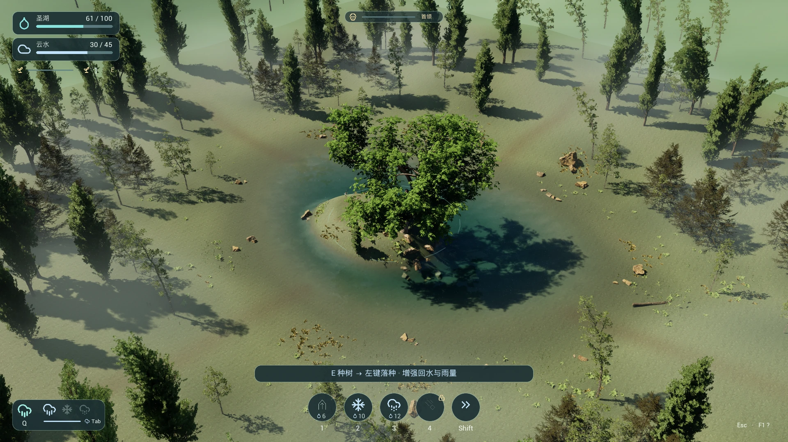
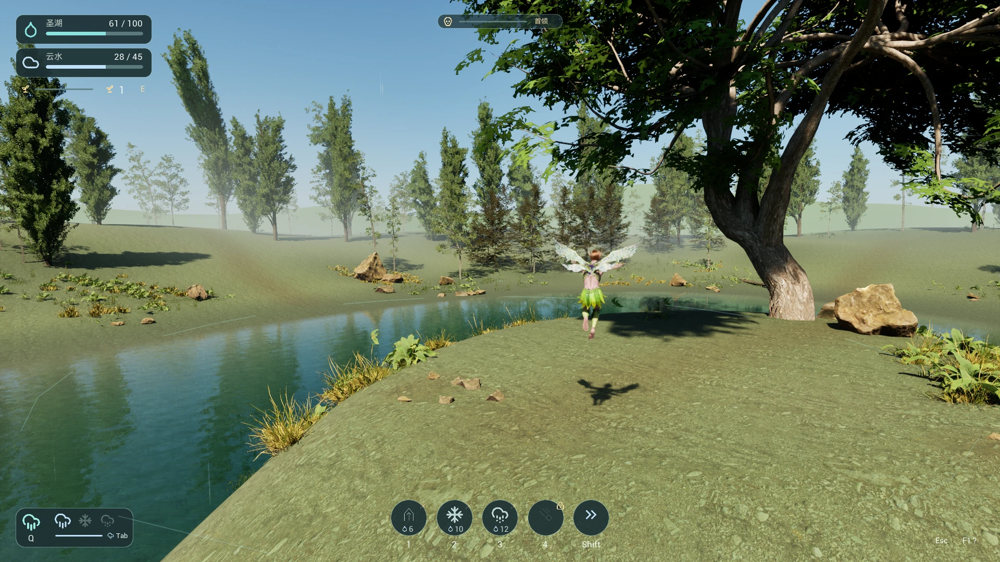
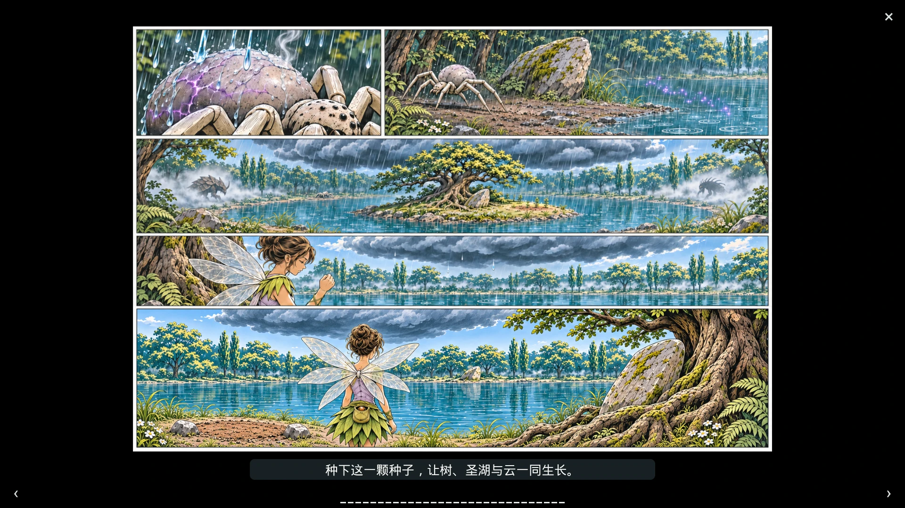

# OneCloud

一款在森林圣湖上空，操控花精灵用雨、雪和冰雹守护家园的防守游戏。种树壮大水循环，把云雨引向来敌，守住湖水并击败首领。







以上为游戏实机截图。

## 仓库包含什么

公开仓库提供 C++ 源码、工程配置、设计与学习文档、素材来源记录和展示图。`Content`、`SourceArt`、`SourceAudio` 中的地图、蓝图及原始美术音频保留在本地，未随仓库发布；其中包含须分别取得许可的第三方素材。具体来源见[资源引用](Docs/Assets.md)。

因此，克隆本仓库可以阅读和构建 C++ 模块，但仅有源码不能直接运行截图中的完整关卡。下面的游玩和编辑步骤适用于已有合法素材与配套蓝图的完整本地工程。

## 开始守湖

使用 **Unreal Engine 5.8** 打开 `OneCloud.uproject`。默认地图是 `/Game/Maps/L_ForestLake`；按 **Play → 开始守湖**，读完或跳过《第一场雨》后开始操控。

漫画中左键逐格推进、右键回看、Esc 跳过；重试会跳过漫画。游戏内按 **F1** 查看帮助，按 **Esc** 暂停并调整音画设置。

## 当前版本怎么操作

| 操作 | 按键 | 用法 |
|---|---|---|
| 飞行、瞄准 | WASD、鼠标 | 沿相机水平朝向移动，用画面中央选择地面落点 |
| 上升、下降 | 空格、左 Ctrl | 松开后悬停 |
| 降水、收雨 | Q 或鼠标右键 | 默认整朵云持续下雨；种植预览时右键用于取消 |
| 聚雨、取消聚雨 | 鼠标左键 | 瞄准云下地面集中一部分雨量，再点原圈附近取消 |
| 切换局部天气 | Tab | 雨 → 雪 → 冰雹；作用于聚雨圈，圈外继续下基础雨 |
| 种树、培育 | E 后左键 | 瞄准湖心岛空地种树，或瞄准已有树根升级；成功后退出预览，右键或 E 取消 |
| 紧急补云 | 按住 F | 靠近岛西仪式石，将湖水转入云；松开停止，自然补云无需按键 |
| 水柱 | 1 | 打断正在取水或蓄力的敌人；普通怪可被推退，重甲与首领不能 |
| 雪幕 | 2 | 区域减速，已经站定的敌人仍会取水 |
| 主动冰雹 | 3 | 范围伤害、短时破甲并打断取水，与 Tab 的持续冰雹分别使用 |
| 星坠 | 4 | 首领存活时解锁，一局一次，预警后造成范围冲击 |
| 侧掠 | 左 Shift | 沿移动方向快速换位 |
| 选择祝福 | 点击或 1 / 2 / 3 | 击败前六只精英各获得一次三选一，选择时暂停防守 |
| 暂停、帮助、重试 | Esc、F1、R 或鼠标中键 | 防守中重试需要确认 |

雨和局部天气需要时间落地：虚线圈表示预览或在途，实线圈表示已抵达地面。云水不足会暂停降水，恢复足够水量后自动续雨；收雨后，空中的雨滴仍会落下。暂停、帮助和祝福界面会结束按住 F 的补云，恢复游戏后需重新按住。

## 一局怎么玩

开局有 60 湖水、35 云水和 1 颗种子。先按 E，在湖心岛较高的空地种下一棵树。每次种植或培育消耗 1 颗种子与 5 湖水，并保留至少 10 湖水；成长需要 12 秒，最多六棵树，每棵三级。树木成长会扩大湖、云容量，增强回水、自然补云和整片云的雨量，容量增加不会直接补满水。

敌人持续从四周森林出现，寻找当前岸线并抽取湖水。用聚雨处理漏防方向，用雪延缓快怪，用冰雹对付重甲；遇到正在取水或首领蓄力时，用水柱或主动冰雹打断。击败普通怪积累种子，击败精英获得种子与祝福，继续种树或升级已有树。湖水不足时先松开 F，留水供成长，必要时收雨等待恢复。

首领默认在防守 990 秒后出现。**湖水归零即失败；保有湖水并击败首领即获胜。** 关卡实例可以覆盖默认计时和数值，完整规则见[森林圣湖玩法](Docs/Architecture.md#森林圣湖怎么玩和怎么读)。

## 快速构建

在 Windows 上准备 UE 5.8 及其 C++ 构建工具链，并确认 `.uproject` 中启用的插件可用。从项目根目录运行；引擎安装在其他位置时替换命令中的路径。

```powershell
& 'C:\Program Files\Epic Games\UE_5.8\Engine\Build\BatchFiles\Build.bat' OneCloudEditor Win64 Development "-Project=$PWD\OneCloud.uproject" -WaitMutex -NoHotReloadFromIDE
```

构建后在编辑器打开 `L_ForestLake` 并 Play 检查实际表现。编译、短时运行、完整一局和发布包分别验证；当前说明不代表稳定 60 FPS 或真人完整长局已经验收。具体检查入口见[构建与验证](Docs/Architecture.md#构建与验证)。

## 工程从哪里看

| 完整本地工程中的目录或入口 | 内容 |
|---|---|
| `Content/Maps/L_ForestLake` | 当前森林圣湖地图，使用 `BP_ForestLakeGameMode` |
| `Source/OneCloud` | 单个运行时模块，下分 `Game / Player / Enemies / Weather / UI`；圣湖规则在 `Game/SacredLake` |
| `Content/Blueprints`、`Content/Input` | 场景配置、角色、敌人、天气、UMG 界面与 Enhanced Input 资产 |
| `Content/Art`、`Content/Audio` | 美术、材质、粒子和声音；素材包保留各自路径 |
| `Config` | 默认地图、输入、渲染与音频配置 |
| `SourceArt`、`SourceAudio`、`Licenses` | 重导入源文件与素材来源记录 |

从[按一次守湖读项目](Docs/Architecture.md#按一次守湖读项目)开始，把游戏现象与蓝图、C++ 对起来；查具体文件看[逐文件理解指南](Docs/Architecture.md#逐文件理解指南)。界面布局在 Widget Blueprint 的 Designer 中调整，入口见[菜单、设置与 HUD](Docs/Architecture.md#菜单设置与-hud-怎样分工)。工程修改与验证约定见 [AGENTS.md](AGENTS.md)。

- [故事设定](Docs/Story.md)：圣湖、结界与《第一场雨》。
- [场景与美术](Docs/Scene.md#森林圣湖)：森林地图、湖水、植被与光照。
- [开场漫画](Docs/OpeningDesign.md#森林圣湖版重制分镜)：七页分镜、逐格演出与编辑入口。
- [玩法与架构](Docs/Architecture.md)：水循环、天气、技能、敌人、界面与代码学习路径。
- [资源引用](Docs/Assets.md)：美术和音频来源；另见[素材许可索引](Licenses/AssetSources.json)与[怪物索引](Licenses/Monsters/Sources.json)，素材使用须核对各自许可。

`L_SacredLake_Prototype` 和 `L_Oasis` 分别是月夜圣湖原型与早期沙漠场景；历史说明保留在[场景文档](Docs/Scene.md)，当前玩法以 `L_ForestLake` 为准。
